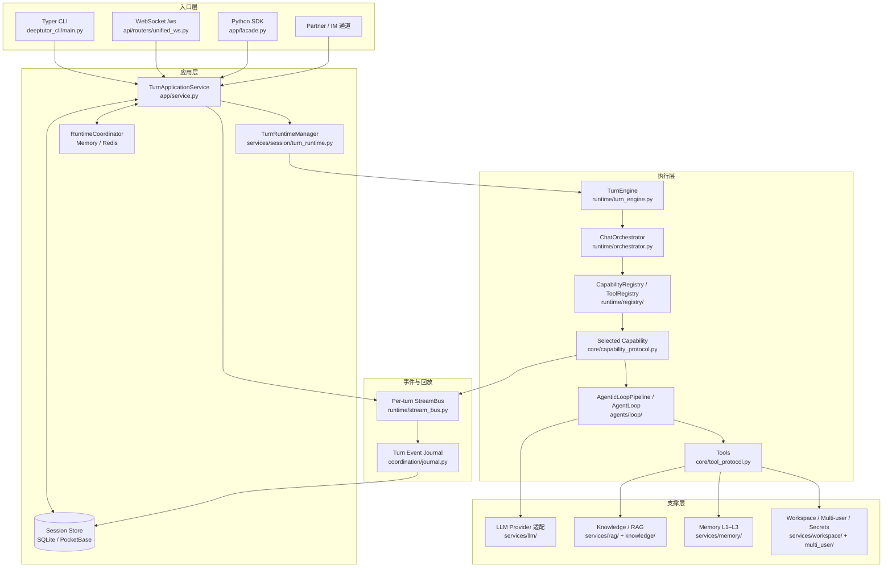
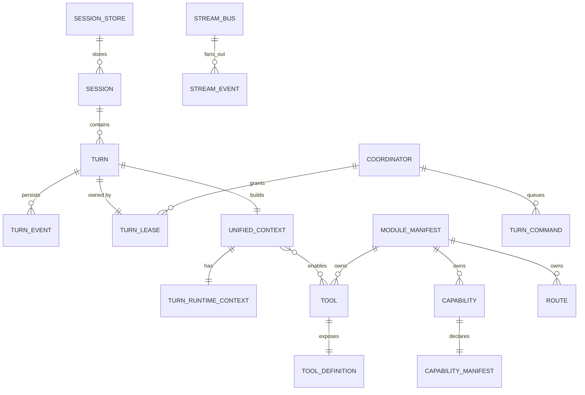
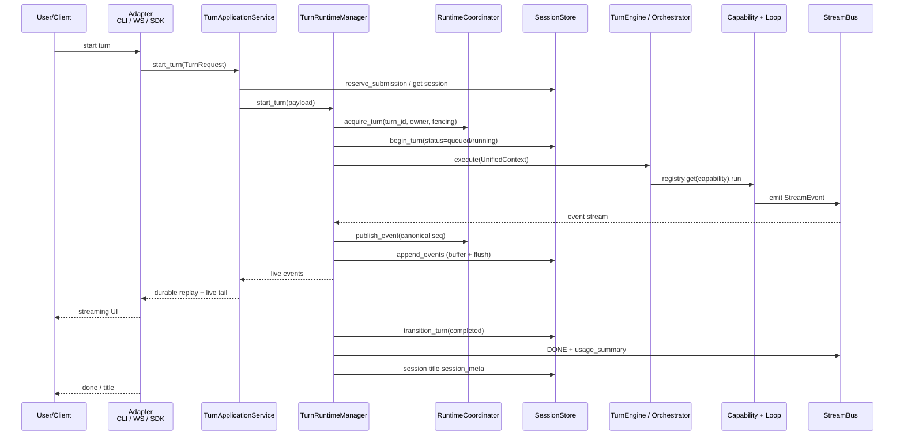

# DeepTutor 架构阅读报告

> 本文按 `how-to-read-code` 工作流整理，目标是把“整体架构”讲清楚，而不是逐文件罗列。
>
> 结论标签：
> - **[static]**：通过阅读源码、manifest、测试与 CI 配置推断，未做运行时验证。
> - **[verified]**：通过实际执行/调试/测试观察到。
>
> 本次没有启动完整应用，所以除特别说明外，架构结论均为 **[static]**。模块贡献清单通过 Node 脚本解析 `deeptutor/modules/manifests/*.json` 得到，属于静态配置核对。

---

## 1. 范围与目的

### 1.1 目的

用户要求：**分析 DeepTutor 项目整体架构，并把结构化架构文档输出到 `mydocs/`**。

因此本文聚焦：

- 系统由哪些顶层部分组成，它们之间如何协作；
- 一次对话 turn 从入口到流式回放的核心链路；
- 工具（Tool）与能力（Capability）两层插件模型；
- 模块化发行、前后端边界、配置与存储、测试与部署；
- 架构为什么会这样设计，以及有哪些值得继续追的开放问题。

### 1.2 环境与运行状态

- 仓库：`D:\workplaceForai\DeepTutor`
- 代码版本：1.7.x 模块化布局（`deeptutor/__version__.py` 为版本权威）
- 当前 shell：Git Bash on Windows
- **未启动完整应用**：当前 shell 中 `python`、`python3`、`py` 均不可用，只有 Node.js 可用；无法执行 `deeptutor run/start`、`pytest` 等命令。
- 已完成的静态核对：
  - 读取入口、应用服务、运行时、能力/工具注册、流式协议、会话存储、协调器、前端边界等核心源码；
  - 用 Node 解析全部模块 manifest，核对能力、工具、路由、命令与导航贡献；
  - 读取 `README.md`、`AGENTS.md`、`docs-for-dev/*`、`pyproject.toml`、`.importlinter`、`.pre-commit-config.yaml`、`.github/workflows/tests.yml`、`web/package.json` 等配置。
- 若要补做运行时验证，建议先准备 Python 3.11–3.14 环境，然后执行：
  - `deeptutor run chat "..." --format json`
  - `python -m pytest tests/app tests/runtime/coordination -q`
  - `deeptutor doctor --format json`

### 1.3 不在范围内

- 每个具体工具/能力内部的算法细节（只保留接口与职责）；
- 每个前端页面的交互实现；
- RAG 各 pipeline、各模型供应商、各 IM 通道的完整内部实现；
- 实验性 TypeScript 引擎的完整行为；
- 生产部署、签名、Docker 镜像构建的完整运维细节。

这些作为“黑盒”记录在第 5 节。

---

## 2. 架构总览（横向）

### 2.1 项目定位与技术栈

DeepTutor 是一个 **agent-native 学习工作台**：同一个运行时同时服务聊天、问答、深度求解、深度研究、可视化、掌握式学习、沉浸阅读、视频课、音频概览等模式。

技术栈：

| 层 | 技术 |
|---|---|
| 后端语言 | Python 3.11–3.14 |
| API | FastAPI + WebSocket + SSE |
| 前端 | Next.js 16 App Router + React 19 + TypeScript + Tailwind |
| 桌面端 | Electron Shell + 打包后的 Python/Node/Next 运行时 |
| 会话存储 | SQLite（默认）/ PocketBase（可选） |
| 协调层 | 进程内 MemoryCoordinator / 多 worker RedisCoordinator |
| 向量/RAG | LlamaIndex、PageIndex、GraphRAG、LightRAG 等可插拔 pipeline |
| 可选基础设施 | Redis、MCP、IM 通道 SDK、Manim/LaTeX、各种文档解析器 |

### 2.2 总体分层图



### 2.3 顶层组件职责

| 组件 | 位置 | 职责 |
|---|---|---|
| CLI | `deeptutor_cli/main.py` | Typer 命令入口；`run`、`chat`、`kb`、`memory`、`module`、`plugin`、`serve`、`start`、`doctor` 等 |
| WebSocket 适配 | `deeptutor/api/routers/unified_ws.py` | 接收 `start_turn` / `cancel` / `submit_user_reply` / `user_input` 命令，订阅并回放 turn 事件 |
| Python SDK | `deeptutor/app/facade.py` | `DeepTutorApp` 门面；统一 workspace 上下文、能力契约、turn 启动与订阅 |
| 应用服务 | `deeptutor/app/service.py` | 持久化 admission、幂等提交、取消、回复、订阅与回放；三个入口共用 |
| 运行时管理器 | `deeptutor/services/session/turn_runtime.py` + `turns/` | 请求准备、上下文装配、租约、执行、终态、会话标题；由 `TurnRuntimeManager` 组合 |
| 执行引擎 | `deeptutor/runtime/turn_engine.py` | 懒加载 orchestrator，执行 `UnifiedContext` |
| 路由编排 | `deeptutor/runtime/orchestrator.py` | 选择 capability、创建 `StreamBus`、处理异常/终态/usage、发布完成事件 |
| 注册表 | `deeptutor/runtime/registry/` | capability/tool 的懒加载、别名、插件、deferred tool 与作用域过滤 |
| 能力 | `deeptutor/capabilities/`、`agents/*` | 拥有一整个 turn 的管线：chat、deep_solve、deep_research、visualize、mastery_path 等 |
| Agent Loop | `deeptutor/agents/loop/` | 通用“探索式”LLM 循环：轮次预算、工具组合、并行工具调用、上下文预算、`ask_user` 暂停/恢复 |
| 工具 | `deeptutor/tools/` | 单次操作，由模型按需选择；内置 + 插件 + MCP/CLI 延迟发现 |
| 流式协议 | `deeptutor/core/stream.py`、`runtime/stream_bus.py` | `StreamEvent` 类型、每 turn 的事件扇出 |
| 协调器 | `deeptutor/runtime/coordination/` | turn 租约、fencing token、命令队列、事件 journal、worker 丢失恢复 |
| 会话存储 | `deeptutor/services/session/` | session / message / turn / event 的持久化；SQLite 与 PocketBase 两种实现 |
| 模块目录 | `deeptutor/modules/` | manifest 驱动的贡献注册、安装/启用/就绪状态、依赖校验 |
| 配置 | `deeptutor/services/config/`、`runtime/home.py` | `DEEPTUTOR_HOME`、`data/user/settings/*.json`、进程环境覆盖 |
| 前端 | `web/` | Next.js App Router、feature 切片、共享 transport、生成的 API/turn contracts |
| 桌面端 | `apps/desktop/` | Electron Shell 管理 bundled Python/Node/Next 的启动、就绪、关闭与签名 |

### 2.4 一次 turn 的核心分层

可以用一句话概括：

> **入口适配器 → 持久化应用服务 → turn 运行时 → 执行引擎 → capability → agent loop/tools → StreamBus → 持久化/协调层 → 适配器回放。**

几个关键设计点：

1. **所有入口都先经过 `TurnApplicationService`**，而不是直接 new 一个 orchestrator。这样持久化、提交幂等、回放、取消、恢复都在同一条路径上。
2. **每个 turn 有独立的 `StreamBus`**；orchestrator 产生事件，turn 运行时负责分配 `seq`、持久化、通过协调器发布，适配器按游标回放。
3. **Capability 拥有一整个 turn**，Tool 只是模型在一次循环中选择的一个操作。
4. **模块 manifest 是包装、运行时和前端贡献的单一事实来源**，避免“代码里有但安装包里没有”或“前端菜单有但后端模块没启用”。

### 2.5 模块化发行模型

`deeptutor/modules/manifests/*.json` 是权威目录。每个 manifest 声明：

- `paths`：该模块拥有的源码路径；
- `requires` / `optional`：模块依赖；
- `capabilities` / `loops` / `tools`：贡献的能力、循环扩展与工具；
- `routes`：FastAPI router 引用、前缀、tags、授权策略（`public` / `authenticated` / `learning` / `admin`）；
- `commands`、`navigation`：CLI 命令与前端导航；
- `requirements`、`executables`：Python 依赖与系统可执行文件。

核心模块族（来自 `docs-for-dev/MODULES.md` 与 manifest）：

| 模块族 | 内容 |
|---|---|
| `core` | 持久 turn、chat、ask_questions、共享工具、CLI/SDK、设置、会话 |
| `server` / `web` | API/认证适配器 / 打包的 Next.js 资产 |
| `solve` / `questions` / `research` | 求解规划循环 / 出题 / 深度研究管线 |
| `visualize` / `renderer-manim` | HTML/SVG/Chart/Mermaid 可视化 / Manim 管线 |
| `video-lesson` / `audio-overview` | 浏览器视频课 / 音频概览 |
| `knowledge` / `parsing` | 知识库检索与摄取 / 文档解析实现 |
| `reading` / `mastery` / `books` | 阅读与观看 / 引导式学习 / 书籍应用 |
| `memory` / `notebook` / `co-writer` / `calendar` | 可选应用服务与路由 |
| `partners` / `providers` | 伴侣/IM 通道 / 可选模型供应商 SDK |
| `parser-*` | 额外解析器依赖，依赖 `parsing` |

三个状态必须区分：

- **installed**：当前 Python 环境是否安装了对应 distribution；
- **enabled**：`<home>/data/system/modules.json` 是否选择启用；
- **ready**：依赖包、版本、系统可执行文件、必需模块是否都满足。

`deeptutor module list` 同时报告这三者；`require_module()` 在能力执行前做硬性检查。

---

## 3. 核心数据结构与关系

### 3.1 结构清单

| 结构 | 定义位置 | 谁创建 | 谁持有 | 谁修改 | 作用 |
|---|---|---|---|---|---|
| `UnifiedContext` | `deeptutor/core/context.py:92` | `TurnExecutor`/上下文装配器 | `TurnEngine`、`ChatOrchestrator`、Capability | Capability、loop、工具的本次 turn 逻辑 | 一个 turn 的全部输入与运行时状态 |
| `TurnRuntimeContext` | `core/context.py:50` | 上下文装配器 | `UnifiedContext.runtime` | 运行时/工具 | 不可序列化的回调、模型历史、workspace 快照、`ask_user` 等 |
| `WorkspaceRuntimeContext` | `core/context.py:34` | workspace 解析 | `TurnRuntimeContext` | 只读 | 冻结本次 turn 的 workspace 根、输出目录、安全级别 |
| `Attachment` | `core/context.py:16` | 请求解析 | `UnifiedContext.attachments` | 解析器 | 图片/文件/PDF 附件 |
| `InteractionState` | `core/context.py:74` | 上下文装配器 | `UnifiedContext.interaction` | loop 与交互式工具 | `end_loop`、用户答案 |
| `CapabilityOutput` | `core/context.py:82` | Capability | `UnifiedContext.capability_output` | Capability | 统一终态输出与事件元数据 |
| `StreamEvent` | `core/stream.py:37` | Capability/Tool/Orchestrator | `StreamBus`、turn 运行时 | 运行时补 `seq`/`turn_id` | 15 种事件类型：stage、thinking、content、tool、result、error、done 等 |
| `TurnRequest` | `app/contracts.py` | 适配器 | `TurnApplicationService` | 验证/工作区改写 | 跨入口统一请求契约 |
| `TurnLease` | `runtime/coordination/types.py:44` | `RuntimeCoordinator.acquire_turn` | `TurnExecutor` | 定期续租 | turn 所有权与 fencing token |
| `TurnCommand` | `coordination/types.py:60` | 适配器/应用服务 | 协调器命令流 | 协调器 | `cancel` / `submit_user_reply` / `user_input` |
| `_TurnExecution` | `services/session/_turn_runtime_shared.py:1422` | `TurnRequestPreparer` | `TurnRuntimeManager` | `TurnExecutor`/`TurnLifecycle` | 进程内执行记录：task、subscribers、events、lease |
| `SessionStoreProtocol` | `services/session/protocol.py:149` | `get_session_store()` | 应用服务/运行时 | 存储实现 | session/message/turn/event 的统一协议 |
| `ToolDefinition` / `BaseTool` | `core/tool_protocol.py:77` / `BaseTool` | 工具实现 | `ToolRegistry` | 注册/发现 | 工具 schema 与执行契约 |
| `CapabilityManifest` / `TurnCapability` | `core/capability_protocol.py:33` / `:46` | 能力实现 | `CapabilityRegistry` | 注册/发现 | 能力元数据与 `run(context, stream)` 契约 |
| 模块 manifest | `deeptutor/modules/manifests/*.json` | 模块作者 | `modules/catalog.py` | 构建/发布 | 贡献归属、依赖、路由、命令、导航 |
| Memory L1/L2/L3 | `services/memory/` | `MemoryStore` / consolidator | 每用户/每 surface | L1 追加、L2/L3 编辑 | 原始轨迹 → 事实 → 综合记忆 |

### 3.2 关系图（概念模型）



> 这是概念关系，不是数据库物理 schema。实际持久化由 `services/session/sqlite_store.py`（约 4,850 行）或 `pocketbase_store.py` 实现。

### 3.3 生命周期要点

1. **`UnifiedContext` 是“每 turn 一次”的对象**。它包含可序列化输入（历史、消息、KB、附件、persona、skills、source manifest）和不可序列化运行时（回调、模型历史、workspace 快照、`ask_user` 回复通道）。
2. **`TurnLease` 是 turn 所有权的唯一证据**。是否存在 lease 决定“这个 turn 还活着”还是“worker 丢了”；不能用 turn 行的 `updated_at` 或事件流是否安静来判断，因为 `ask_user` 暂停时本来就不产生事件。
3. **事件 `seq` 属于持久化协议**。`_publish_live_event()` 在协调器发布时拿到规范序号，然后写入 `execution.events`，再批量 flush 到 store；客户端用 `after_seq` 回放。
4. **终态先落库，DONE 后可见**。turn 运行时先 flush 非终态事件、再 `transition_turn`、再发布 DONE，最后 flush，避免“客户端看到 DONE 但持久化前缀缺失”。
5. **`StreamBus` 是进程内扇出，不是持久化本身**。真正的 durable replay 依赖 `TurnEventJournal` + session store；`StreamBus` 关闭后，订阅者仍可从 `store.get_events()` 回放。

---

## 4. 纵向分析：一次 `chat` turn 的完整执行路径

### 4.1 入站与 admission

入口可以是：

- CLI：`deeptutor run chat "..."` / `deeptutor chat`；
- WebSocket：`/ws` 上的 `start_turn` 命令；
- SDK：`DeepTutorApp.start_turn(...)`；
- Partner/IM 通道。

它们最终都进入 `TurnApplicationService`。

`TurnApplicationService.start_turn()`（`app/service.py:113`）做：

1. 验证 `TurnRequest`；
2. 若未处于 workspace context，根据 request 的 `workspace_id` 包一层 `workspace_context`；
3. 解析 store + `TurnRuntimeManager`；
4. **幂等提交**：若带 `client_submission_id` 且需要持久化用户消息、非 regenerate，则调用 `store.reserve_submission(...)`；如果同一 submission 已有非失败 turn，直接返回原结果；
5. 调用 `runtime.start_turn(payload)`；
6. 处理 `ActiveTurnConflict`：若无 lease 的僵尸 turn 阻塞 session，尝试 reclaim 后重试一次；
7. 更新 session preferences（语言、引用、KB、workspace dependencies）。

这一层的关键词是 **admission**：它不直接执行模型，只负责“这次提交是否已被接受、是否重复、是否与现有 turn 冲突”。

### 4.2 请求准备、租约与 turn 行

`TurnRuntimeManager`（`services/session/turn_runtime.py:26`）是六个职责切片的组合：

- `TurnRequestPreparer`
- `TurnContextAssembler`
- `LearningTurnAdapter`
- `TurnExecutor`
- `TurnLifecycle`
- `SessionTitleService`

`TurnRequestPreparer` 的核心动作（`services/session/turns/request_preparer.py:795` 附近）：

1. 解析 session、capability、workspace mode、persona、LLM selection、附件、memory references、KB、mastery/reading 绑定等；
2. 如果有 `coordinator`，生成 `turn_id` 并 `acquire_turn(turn_id, "{scope}:{session_id}", owner_id)`；
3. 租约成功后才 `store.begin_turn(...)`，写入 `queued`/`running` 的 turn 行，并带上 `owner_id`、`fencing_token`；
4. 在进程内 `_executions` 注册 ownership marker，防止两个并发的 `start_turn` 把健康 turn 误判为重启孤儿；
5. 若是 mastery 路径，还可能额外获取 mastery path lease；
6. 发布进入事件，启动执行任务。

**顺序很重要**：先拿 lease，再插 turn 行。这样新 turn 在第一次续租前就已经受保护；而恢复逻辑看到“有行但无 lease”时，才能判定 worker 丢失。

### 4.3 上下文装配

`TurnExecutor`（`services/session/turns/executor.py:69`）负责把请求变成一个 `UnifiedContext`：

- 读取历史消息（含分支选择、`parent_message_id`）；
- 读取 memory、learning journal、persona、skills、source manifest；
- 解析附件、引用、question bank、book/reading/mastery 上下文；
- 读取 LLM 配置、注入 provider 状态；
- 创建 `UnifiedContext`，把不可序列化状态放进 `context.runtime`；
- 调用 `self.turn_engine.execute(context)`。

这一层是“**上下文装配器**”，不决定具体能力；它只把本次 turn 需要的所有材料准备好。

### 4.4 引擎与 capability 路由

`TurnEngine.execute()`（`runtime/turn_engine.py:17`）非常薄：

```text
interactive_memory_scope()
  -> ChatOrchestrator()
  -> orchestrator.handle(context)
```

`ChatOrchestrator.handle()`（`runtime/orchestrator.py:64`）：

1. 若 `context.knowledge_bases` 非空，`require_module("knowledge")`，并校验 PageIndex OSS 选择；
2. 若 `context.runtime.answer_by` 有值，选择 `HandoffCapability`（伴侣/外部 agent 代答），而不是注册表中的普通能力；
3. 否则 `cap_name = context.active_capability or "chat"`，从 `CapabilityRegistry.get(cap_name)` 取能力；
4. 发一个 `SESSION` 事件；
5. 创建 `StreamBus`，按 `turn_id` 注册；
6. 在独立 task 中执行 `capability.run(context, bus)`：
   - 正常返回且 `bus.result_completion is False` → 标记 `capability_incomplete`；
   - 异常 → 发 `error` 事件，保留 `error_code` / `retryable` / `partial_response`；
   - `finally` → 发 `DONE`，带上 `status`、错误元数据和 `usage_summary`；
7. 消费端提前停止时取消执行 task，避免“已经报停的 turn 还在调用模型/工具”；
8. 最后向全局 `EventBus` 发布 `CAPABILITY_COMPLETE`。

`CapabilityRegistry`（`runtime/registry/capability_registry.py:58`）本身是一个**兼容外观**，底层是 `CapabilityCatalog`：

- 内置能力用懒加载 factory（`load_builtins()`，`:85`）；
- 插件能力来自 `deeptutor.extensions` entry point，兼容旧的 `deeptutor.plugins`；
- 第三方 runtime plugin 也可通过 `PluginWorkerCapability` 注入；
- `contribution_enabled()` 会检查所属模块是否启用、贡献依赖是否满足。

### 4.5 Agent loop 与工具编排

`chat` 能力本身几乎只是名字（`agents/chat/capability.py:12`）：

```text
ChatCapability.run
  -> AgenticChatPipeline
    -> AgenticLoopPipeline（通用 loop host）
      -> 具体 prompt pack / 工具组合 / LLM rounds
```

`AgenticLoopPipeline`（`agents/loop/pipeline.py:200`）拥有：

- LLM client 与 provider 配置；
- 轮次/token 预算（默认 `DEFAULT_MAX_ROUNDS = 8`，结束时通常是一轮没有工具调用）；
- `ToolMountFlags` + 用户 toggle + capability 自带工具 → 最终工具列表；
- 消息列表与上下文预算（`context_budget.py`）；
- 工具派发、并行调用、参数注入、trace；
- capability hooks、`ask_user` 暂停/恢复、`END_LOOP`。

工具组合的单一策略在 `agents/_shared/tool_composition.py`：

- `AUTO_MOUNTED_TOOLS`：由 pipeline 根据上下文自动挂载，不出现在用户设置；
- `CONDITIONAL_MOUNT_FLAGS`：`has_kb` → `rag`/`kb_files`，`has_memory` → `read_memory`，`has_exec` → `exec` 等；
- `WORKSPACE_BASELINE_TOOLS`：workspace 工具是共享内容面，不被能力专用工具面挤掉；
- 用户 toggle 的工具列表来自 `USER_TOGGLEABLE_TOOL_NAMES`。

这里的设计原则是：

> **切换模式不能悄悄拿掉用户已经打开的工具。**  
> 专用 loop 继承 chat 的工具面，再叠加自己的工具；只有显式 override 才收窄。

### 4.6 事件持久化与回放

当 capability 向 `StreamBus` 发事件，`TurnExecutor` 的 `_publish_live_event()`（`services/session/turns/lifecycle.py:681`）负责：

1. 给 DONE 补 `usage_summary`；
2. 补 `session_id`、`turn_id`；
3. 若协调器存在，调用 `coordinator.publish_event(turn_id, payload)`，由协调器分配/返回规范 `seq`；
4. 在 `_lock` 内把事件追加到 `execution.events`，维护 `next_seq`；
5. 对于 DONE 或事件积压 ≥25 条，立即 `_flush_buffered_events()`；否则启动一个 0.25s 的延迟 flush task；
6. 推给当前进程内所有 live subscriber。

`subscribe_turn()`（`app/service.py:248`）的回放逻辑：

1. 先从 `store.get_events(turn_id, after_seq)` 做 **durable replay**；
2. 再通过 `coordinator.read_events(turn_id, after_seq)` 读取其他 worker 的 live tail；
3. 如果看到 DONE 且没有“完成后标题”尾巴，直接结束；若 DONE 后仍可能有 post-turn 事件（例如标题 `session_meta`），会继续等待 lease 消失；
4. 如果 turn 行已是终态但 durable 事件里没有 DONE，会合成 `error` + `done`，避免客户端永远等不到结束。

因此，**浏览器断线、进程重启、Redis 重启都不会让一个已持久化的 turn 丢失**；客户端只需带回 `after_seq`。

### 4.7 终态、取消与恢复

- **正常完成**：flush 非终态事件 → `transition_turn(completed)` → 发布 DONE → flush → 生成标题 `session_meta` → 最终 flush。
- **取消**：`TurnApplicationService.cancel_turn()` 通过协调器发 `cancel` 命令；执行侧在 `CancelledError` 分支尽量持久化已经产出的答案文本、附件和 trace，然后标记 `cancelled`；已产生的文件保留。
- **worker 丢失**：`TurnRecoveryService`（`runtime/coordination/recovery.py:15`）由 leader 周期运行：
  - 找到过期 lease；
  - 若 lease 仍在 → 跳过；
  - 把过期 worker 的剩余事件先 append 到 durable journal；
  - 以 `fencing_token` 做 CAS，把 turn 标记为 `failed`、`failure_code = worker_lost`、`retryable = true`；
  - 写入 `error` + `done` 事件并发布。
- **僵尸 turn**：应用服务在新提交被 `ActiveTurnConflict` 阻塞时，会同步 reclaim “没有 lease 的活跃行”，避免一个丢失 worker 的行永久阻塞整个 session。

### 4.8 时序图



### 4.9 静态调用路径

> 以下为 **[static]** 路径，未获得运行时 backtrace。若要验证，建议在 `TurnApplicationService.start_turn`、`TurnExecutor` 的 `turn_engine.execute` 调用处、`ChatOrchestrator.handle` 三处下断点。

```text
deeptutor_cli/main.py: run / chat
  -> deeptutor/app/facade.py: DeepTutorApp.start_turn
    -> deeptutor/app/service.py: TurnApplicationService.start_turn
      -> deeptutor/services/session/turns/request_preparer.py: TurnRequestPreparer
        -> deeptutor/runtime/coordination/: acquire_turn
        -> deeptutor/services/session/: begin_turn
        -> deeptutor/services/session/turns/executor.py: TurnExecutor
          -> deeptutor/runtime/turn_engine.py: TurnEngine.execute
            -> deeptutor/runtime/orchestrator.py: ChatOrchestrator.handle
              -> deeptutor/runtime/registry/capability_registry.py: get
              -> deeptutor/agents/chat/capability.py: ChatCapability.run
                -> deeptutor/agents/chat/agentic_pipeline.py: AgenticChatPipeline
                  -> deeptutor/agents/loop/pipeline.py: AgenticLoopPipeline
                    -> deeptutor/agents/loop/agent_loop.py / runtime/agentic
```

---

## 5. 黑盒（有意没有展开）

| 接口/模块 | 输入 | 输出/效果 | 为什么不展开 |
|---|---|---|---|
| `services/llm/provider_core/*`、`provider_factory.py` | 模型配置、API key、wire format | provider client、流式 completion、usage | 供应商适配细节多；本次只关心“能力如何拿 LLM” |
| `services/rag/pipelines/*` | KB 名称、文件、查询 | 索引、检索结果、引用 | RAG 是独立子系统；只保留 `RAGService` 入口 |
| `services/parsing/*`、`parser-*` 模块 | 文档路径/字节 | 提取文本、图片、结构 | 解析器实现与具体库强耦合，属于 subplot |
| `deeptutor/plugins/runtime.py`、`lifecycle.py` | 插件 manifest、审批、worker | 插件 capability/tool/frontend | 第三方插件协议复杂；本次只记录“有独立审批与 worker 边界” |
| `services/mcp/*` | MCP 配置、OAuth、secrets | MCP 工具发现与调用 | 外部协议集成，非主链路 |
| `services/cli_apps/*` | CLI app manifest、安装状态 | `exec` 可用的命令 | 外部工具安装器，非主链路 |
| `deeptutor/partners/channels/*` | IM 消息、附件 | 统一 turn 请求 | 通道适配器多；只保留“Partner 走应用服务” |
| `apps/desktop/src/*`、`platforms/*` | 打包运行时 | Electron 启动/关闭/签名 | 桌面发布是独立工程 |
| `packages/chat-engine/src/*`、`runtime/ts_engine/*` | 种子上下文、scoped ports | TS 原生 agent 执行 | 实验性路径；默认 Python 调度器才是主链路 |
| `web/features/*` 各 feature 内部 | contracts、store、transport | React UI | 前端页面级细节；只保留边界规则 |

---

## 6. 设计评论与开放问题

### 6.1 为什么这样设计

1. **先做持久化应用服务，再做 turn 执行**
   - 三个入口（CLI、WS、SDK）共享 admission、幂等、回放、取消、恢复。
   - 浏览器断开不等于 turn 失败，也不授权第二个执行；`TurnLease` 是唯一活性证据。
   - 代价是链路更长：`TurnApplicationService → TurnRuntimeManager → TurnEngine → Orchestrator → Capability`。

2. **Tool / Capability 两层**
   - Tool 适合“模型自己决定何时调用”的单步操作；
   - Capability 适合“必须按阶段执行、需要自己的提示词/预算/工具面”的完整 turn。
   - 这避免了把所有模式都塞进一个巨大的 chat prompt，也避免每个模式都重新实现 session/stream/usage。

3. **manifest 驱动模块**
   - 同一个 JSON 同时服务：源码归属、wheel 打包、运行时注册、API 路由、CLI 命令、前端导航。
   - `modules/catalog.py` 在读取 manifest 时不导入 feature 实现，保证 core 安装不会因为可选依赖缺失而启动失败。
   - 代价是 manifest 必须保持无环、无重复归属、路径前缀合法；`manifests()` 会主动校验。

4. **StreamBus + durable seq**
   - 进程内 fan-out 负责低延迟；持久化 journal 负责重连/重启/多 worker。
   - `seq` 由协调器统一分配，避免“每个进程从 1 开始”导致回放错过事件。
   - 代价是事件协议和 sequence 语义成为公共契约，改动需要覆盖重连、部分输出、取消、worker 丢失。

5. **import-linter + 架构测试**
   - `.importlinter` 明确三条规则：core 不能反向依赖 app/api/runtime/services；runtime/services/... 不能 import api；app 不能 import api。
   - `scripts/check_architecture.py` 补充边界检查。
   - 这让“共享协议保持轻量”不只是口头约定，而是 CI 门禁。

### 6.2 如果是我，会怎样不同

- **收敛 turn 运行时的“切片 + 兼容层”**：`TurnRuntimeManager` 组合了 6 个 mixin，`_turn_runtime_shared.py` 仍保留约 1,700 行的兼容值层；`executor.py`（约 1,550 行）和 `lifecycle.py`（约 820 行）承担了非常多的 turn 语义。若重新设计，我会把“admission / context assembly / streaming journal / terminalization / title”拆成更明确的接口，减少 mixin 之间的隐式依赖，并用一个显式的 `TurnState` 状态机替换散落在多个文件里的状态判断。
- **统一 capability/tool 协议命名**：当前有 `core/capability_protocol.py`（`TurnCapability`）与 `capabilities/protocol.py`（loop extension 常量/协议）两个相近命名的协议模块；新人容易误判权威定义。若重构，我会在文档和模块 docstring 中明确“core 是稳定协议，capabilities 是 loop 扩展协议”，或进一步合并。
- **减少兼容 facade**：`CapabilityRegistry` 是 `CapabilityCatalog` 的兼容外观，`tool_registry` 也同时管理 builtin spec、alias、deferred、plugin。兼容层对迁移有价值，但长期应明确“唯一权威”，避免两套注册路径逐渐漂移。
- **把“可用性”从执行时检查前移为显式 contract**：当前 `contribution_enabled()`、`require_module()`、`ToolMountFlags` 在多个点检查；可以考虑在 turn 开始时生成一个 `TurnCapabilityPlan`（能力 + 工具 + 资源权限 + 模块状态），让执行阶段只消费计划，减少“发现时允许、派发时又拒绝”的不一致。

### 6.3 可疑点/需要继续验证的问题

- `_turn_runtime_shared.py` 的注释说“decomposed v2”，但 `turn_runtime.py` 只有 55 行，真正的值层仍集中在一个大文件；这是**有意的过渡层**还是尚未完成的拆分，需要结合 git 历史确认。
- `AgenticLoopPipeline` 约 2,057 行，`tool_dispatch.py` 约 955 行；工具编排的边界是否还能进一步下沉到 `runtime/agentic/`，值得评估。
- `docs-for-dev/RUNTIME_DESIGN.md` 明确说“私有 model history 与展示历史分离”；这与 `services/session/model_history.py`、`provider_response_state.py` 的持久化字段相关。若要做 provider 兼容性改动，应先读这些契约。
- 本次没有运行测试，无法确认当前分支的测试状态；CI 配置显示 Python 3.11–3.14 矩阵、Redis、LightRAG/GraphRAG、Windows 导入检查、视频沙箱和多 worker E2E 都有覆盖，但本地未验证。

---

## 7. 后续阅读建议

- [ ] **跑通一次真实 turn**：准备 Python 环境后，在 `TurnApplicationService.start_turn`、`TurnExecutor` 调用 `turn_engine.execute` 的位置、`ChatOrchestrator.handle` 下断点，观察 `UnifiedContext`、lease、事件 seq。
- [ ] **打开 RAG 黑盒**：读 `services/rag/factory.py`、`services/rag/pipelines/*`、`knowledge/indexing_run.py`，理解 KB 绑定、索引版本、发布状态。
- [ ] **打开 provider 黑盒**：读 `services/llm/provider_factory.py`、`provider_core/base.py`、`request_cache.py`、`usage.py`，理解 wire format、重试、usage 记账。
- [ ] **验证多 worker 协调**：用 Redis coordinator 跑两个 worker，观察 lease、fencing、`worker_lost` 恢复。
- [ ] **读前端 chat transport**：`web/features/chat/transport`、`web/lib/reconnecting-websocket.ts`、`web/lib/stream.ts`、`web/lib/turn-reconcile.ts`，理解 `after_seq` 重连与消息 reconciliation。
- [ ] **读插件/伙伴链路**：`deeptutor/plugins/runtime.py`、`deeptutor/partners/channels`、`deeptutor/services/partners`。
- [ ] **读实验性 TS engine**：`packages/chat-engine/README.md` + `deeptutor/runtime/ts_engine/`，确认它与 Python 应用服务的边界。
- [ ] **跑 CI 等价检查**：`python -m pytest tests deeptutor/learning/tests`、`lint-imports`、`python scripts/check_architecture.py`、`(cd web && npm run check:fast)`。

---

## 8. 横向补充：工具、能力与模块

### 8.1 Level 1 — Tool

定义：`BaseTool` / `ToolDefinition` / `ToolResult`（`deeptutor/core/tool_protocol.py`）。一个工具是“模型选择的一次操作”。

内置工具分三类：

1. **用户可开关的 8 个工具**（`USER_TOGGLEABLE_TOOL_NAMES`）：
   `brainstorm`、`web_search`、`paper_search`、`zotero_search`、`reason`、`geogebra_analysis`、`imagegen`、`videogen`。
2. **上下文自动挂载的工具**（`CONFIGURABLE_BUILTIN_TOOL_NAMES` + `ToolMountFlags`）：
   `rag`、`kb_files`、`read_source`、`read_memory`、`read_skill`、`load_tools`、`exec`、`ask_user`、`list_notebook`、`save_favorite`、`question_bank`、mastery 导航等。
3. **能力私有工具**：
   `solve_plan` / `solve_finish_step` / `solve_replan`（deep_solve）、`submit_visualization`（visualize）、mastery 系列、reading 系列、partner 系列等。

工具发现还支持：

- **deferred tools**：`ToolRegistry.deferred_tools()` + `load_tools`，渐进式披露；
- **别名**：`TOOL_ALIASES` / `_resolve_request`；
- **作用域过滤**：`ScopedToolRegistry`、`ToolScope`；
- **插件与 MCP/CLI**：entry point、`deferred_tools.py`、MCP manager、CLI apps。

可用性不等于权限：账户授权、workspace 资源策略、模块状态、能力激活、Partner allow/deny 都必须在发现和派发两个环节保持有效。

### 8.2 Level 2 — Capability

定义：`TurnCapability` / `CapabilityManifest`（`core/capability_protocol.py`）。一个能力拥有整个 turn，消费 `UnifiedContext` 并向 `StreamBus` 发事件。

内置能力清单（来自 manifest）：

| Capability | 所属模块 | 阶段/形态 |
|---|---|---|
| `chat` | core | exploring → responding（单 agent loop，默认） |
| `ask_questions` | core | responding（chat loop 强制走 `ask_user`） |
| `deep_solve` | solve | responding（chat loop + solve planning tools） |
| `deep_question` | questions | ideation → generation |
| `deep_research` | research | rephrasing → decomposing → researching → reporting |
| `visualize` | visualize | analyzing → generating → reviewing；可按 `render_type` 路由到 Manim 子阶段 |
| `math_animator` | renderer-manim | concept_analysis → concept_design → code_generation → code_retry → summary → render_output |
| `mastery_path` | mastery | responding（Guided Learning，chat loop + mastery tools，按 topic type 门控） |
| `immersive_reading` | reading | responding（文档/时间戳 grounded 的阅读循环） |
| `video_lesson` | video-lesson | code_generation → render_check → render_output |
| `audio_overview` | audio-overview | retrieving → script_writing → voice_generation → publishing |

所有能力都应在结束时调用：

```text
emit_capability_result(stream, payload, source=..., usage=...)
```

（`agents/_shared/capability_result.py:21`）。它会合并 `cost_summary` 与 `usage_summary`，再发 `RESULT`。Orchestrator 负责 DONE 和异常终态；能力不应自己发明另一套 completion envelope。

### 8.3 Loop extensions

除能力外，还有可插拔的 loop extension（`deeptutor/capabilities/*/loop.py` 等）：

- `ask_questions`、`subagent`、`explore_context`、`setup`、`creator`（core）；
- `mastery`、`immersive_reading`、`solve`、`visualization_generation`；
- `notes`（co-writer）、`partner_authoring`、`partner_group`；
- `obsidian`、`marginnote4`、`ima`（knowledge）。

它们通过 `PluginRegistry` / `Extension` 注册，向 loop 提供工具、提示词块或生命周期钩子。

### 8.4 模块与安装

- 源码检出：`module enable/disable` 改变 `<home>/data/system/modules.json`；所有源码都在树上。
- wheel 环境：`module install/uninstall` 真正安装/移除 distribution。
- `python scripts/sync_module_requirements.py --check` 检查生成 requirements 是否漂移。
- `python scripts/build_modules.py --output dist/modules` 构建本地 wheel 族。
- `deeptutor[full]` 是安装 profile，不是永久 metapackage；任何 feature 都能单独卸载。

---

## 9. 横向补充：前端与 API

### 9.1 后端 API

- `deeptutor/api/main.py`：FastAPI 应用工厂/生命周期；启动时 `validate_tool_consistency()` 校验 capability manifest 引用的工具都存在。
- `deeptutor/api/router_loader.py`：按 manifest 的 `reference` 加载 router；实验性 native profile 下可用 `router_index.json` 做延迟路由，未加载的路由先注册匹配 pattern，实际请求到达时再 import。
- `deeptutor/api/routers/`：约 48 个领域 router（auth、sessions、knowledge、book、reading、mastery、memory、notebook、partners、plugins、mcp、settings、workspace、unified_ws 等）。
- 授权策略来自 manifest：`public` / `authenticated` / `learning` / `admin`；`deeptutor/api/security_guard.py` 做请求筛选。
- `unified_ws.py`：命令协议（`start_turn`、`cancel`、`submit_user_reply`、`user_input`）+ `command_ack`；订阅是只读的，包括 owner 消失、leader recovery 尚未完成时。

### 9.2 前端边界

- `web/app/`：Next.js App Router 页面组合：
  - `(workspace)`：home、chat、learning（books/mastery/reading/watching）、co-writer、partners、calendar、kanban、whisper；
  - `(utility)`：space、memory、knowledge-bases、notebooks、agents、personalization、profile、settings；
  - `(settings)`、`(auth)`、`(admin)`；
  - `handoff/page.tsx`。
- `web/features/`：领域切片，例如 `chat` 下有 `components/`、`controllers/`、`model/`、`selectors/`、`transport/`、`trace/`。
- `web/shared/`：`api`、`auth`、`storage`、`ui` 等原语。
- `web/contracts/`：由 `npm run contracts:generate` 生成，来自后端 schema；不要手改。
- `web/proxy.ts`：把 `/api/*` 和 `/ws/*` rewrite 到后端；多用户模式下做登录跳转；不在客户端硬编码部署地址。
- `web/.dependency-cruiser.cjs` 禁止：
  - 循环依赖；
  - `contracts/` 反向依赖；
  - `shared/` 向上依赖 `app|components|context|features`；
  - `features/*/(model|store|transport)` 依赖渲染层；
  - `lib/` 依赖 UI；
  - 任何模块 import `page.tsx`。

### 9.3 前端传输与重连

- `web/lib/reconnecting-websocket.ts`、`web/lib/stream.ts`、`web/lib/session-events.ts`、`web/lib/turn-reconcile.ts` 负责：
  - 连接 `/ws`；
  - 用 `after_seq` 断线续传；
  - 处理 DONE 之后可能仍有 `session_meta` 的尾巴；
  - 把持久化消息与流式 trace 做 reconcile。
- 修改 stream/event 行为时，前端与后端契约必须一起变，并跑 `npm run contracts:check`。

---

## 10. 横向补充：配置、存储、多用户与安全

### 10.1 运行时 home

- `DEEPTUTOR_HOME` 指向“拥有 `data/` 的目录”，不是 `data/` 本身。
- `runtime/home.py` 解析 home；`services/config/runtime_settings.py` 管理 `data/user/settings/*.json`。
- 项目根 `.env` **不会**自动加载；容器有自己的 JSON→环境变量入口。
- 常用文件：
  - `data/user/settings/main.yaml` / `interface.json` / `model_catalog.json` / `system.json`；
  - `data/system/modules.json`（启用状态）；
  - `data/user/logs/deeptutor.jsonl`；
  - `data/user/runtime/launcher.log`（detached 启动）。

### 10.2 会话存储

- `services/session/sqlite_store.py`：默认实现，包含 session、message、turn、event、usage、notebook、question bank 等表。
- `services/session/pocketbase_store.py`：可选后端，协议相同。
- `SessionStoreProtocol` 分为 `SessionRepository` / `TurnRepository` / `MessageRepository`。
- turn 事件以 `seq` 持久化；`get_events(turn_id, after_seq)` 是回放基础。
- `services/session/model_history.py` 保存私有 `model_turn`（provider 准备后的消息、快照、工具结果、replay metadata），公共 session 响应会 redact。
- `services/session/turns/title_service.py` 在 DONE 之后生成标题 `session_meta`；前端会短暂保持 socket 等待它。

### 10.3 Workspace 与多用户

- `services/workspace/`：内容 workspace 的路径、目录、资源、迁移、渲染存储、session 移动。
- `services/path_service.py`：当前账户/workspace 的路径解析；不要构造全局 data 路径。
- `multi_user/`：账户身份、guardian、grants、book/knowledge/learning/model/partner/skill/tool access、per-account secrets、session handoff。
- `tests/conftest.py` 有自动 guard：测试不能写入真实 per-account secret tree，也不能迁移真实 `multi-user/`。

### 10.4 安全边界

- `services/mcp/secrets.py`：MCP 凭据与用户配置分离；
- `services/cli_apps/`：CLI app 安装/运行，`exec` 需显式挂载；
- `runtime/isolated_worker.py`：短生命周期解析 worker，不是不可信代码的 OS 沙箱；
- `services/sandbox/`：视频/代码执行的取消、超时、进程树清理；
- 任何浏览器响应都不得返回凭据或私有 provider replay metadata。

---

## 11. 横向补充：测试、CI 与部署

### 11.1 Python 检查

```bash
python -m pytest -q tests/path/to/test_file.py
python -m pytest -q tests/path/to/test_file.py::test_name
python -m pytest -q tests/app tests/runtime/coordination
python -m pytest -q tests deeptutor/learning/tests

python -m ruff check .
python -m ruff format --check .
lint-imports
python scripts/check_architecture.py
python scripts/sync_module_requirements.py --check
python scripts/check_repo_hygiene.py
python scripts/check_workspace_hygiene.py   # 需要干净工作树
pre-commit run --all-files
```

### 11.2 Web 检查

```bash
cd web
npm run typecheck
npm run architecture:check
npm run test:node
npm run test:unit
npm run lint
npm run i18n:check
npm run contracts:check
npm run check:fast
npm run check          # + production build + route budgets
npm run contracts:generate
npm run audit           # Playwright，需要运行中的前端
```

### 11.3 CI 覆盖（`.github/workflows/tests.yml`）

- Python 3.11/3.12/3.13/3.14 矩阵；
- Redis service，供 `DEEPTUTOR_TEST_REDIS_URL`；
- 可选 LightRAG / GraphRAG；
- 导入检查：关键模块 import、懒加载、isolated worker 协议；
- Windows 进程所有权与 hidden launch；
- Web `npm run check` + Playwright audit；
- 桌面 shell（Ubuntu/Windows）；
- 实验性 TypeScript chat engine；
- 视频课沙箱（Ubuntu/macOS/Windows）；
- 多 worker浏览器验收（需 `DEEPTUTOR_MULTI_WORKER_E2E_URL`）。

### 11.4 部署形态

- **源码/CLI**：`deeptutor start --dev`、`deeptutor serve`、`deeptutor run`。
- **PyPI 模块**：`deeptutor[full]` 或核心 `deeptutor`；feature wheels 必须同版本。
- **Docker**：`compose.yml` / `compose.yaml` / Dockerfile；单端口 3782 的 Web 应用或分离端口。
- **桌面**：`apps/desktop` 的 Electron shell + bundled Python/Node/Next；发布要求 Intel Mac、Apple Silicon、Windows installer、portable ZIP 全部齐全，并等待 `verify-release`。

---

## 12. 关键文件索引

| 主题 | 入口文件 |
|---|---|
| CLI | `deeptutor_cli/main.py` |
| SDK 门面 | `deeptutor/app/facade.py` |
| 应用服务 | `deeptutor/app/service.py` |
| 容器/依赖注入 | `deeptutor/app/container.py` |
| Turn 运行时 | `deeptutor/services/session/turn_runtime.py` |
| Turn 请求准备 | `deeptutor/services/session/turns/request_preparer.py` |
| Turn 执行 | `deeptutor/services/session/turns/executor.py` |
| Turn 生命周期/事件 | `deeptutor/services/session/turns/lifecycle.py` |
| 会话存储协议 | `deeptutor/services/session/protocol.py` |
| SQLite 存储 | `deeptutor/services/session/sqlite_store.py` |
| Turn 引擎 | `deeptutor/runtime/turn_engine.py` |
| Orchestrator | `deeptutor/runtime/orchestrator.py` |
| 能力注册 | `deeptutor/runtime/registry/capability_registry.py` |
| 工具注册 | `deeptutor/runtime/registry/tool_registry.py` |
| 能力/工具协议 | `deeptutor/core/capability_protocol.py`、`core/tool_protocol.py` |
| 流式事件 | `deeptutor/core/stream.py`、`runtime/stream_bus.py` |
| 协调器 | `deeptutor/runtime/coordination/` |
| 恢复 | `deeptutor/runtime/coordination/recovery.py` |
| Agent loop | `deeptutor/agents/loop/pipeline.py`、`agents/loop/agent_loop.py` |
| 工具组合 | `deeptutor/agents/_shared/tool_composition.py` |
| 能力结果 | `deeptutor/agents/_shared/capability_result.py` |
| 模块目录 | `deeptutor/modules/catalog.py`、`modules/manifests/*.json` |
| RAG | `deeptutor/services/rag/service.py`、`services/rag/pipelines/` |
| Memory | `deeptutor/services/memory/` |
| LLM | `deeptutor/services/llm/provider_factory.py`、`provider_core/` |
| API | `deeptutor/api/main.py`、`api/routers/unified_ws.py` |
| 前端 | `web/app/`、`web/features/`、`web/shared/`、`web/contracts/` |
| 前端代理 | `web/proxy.ts` |
| 前端依赖规则 | `web/.dependency-cruiser.cjs` |
| 桌面 | `apps/desktop/` |
| 实验 TS 引擎 | `packages/chat-engine/`、`deeptutor/runtime/ts_engine/` |

---

## 13. 结论

DeepTutor 的核心不是“一个聊天机器人”，而是：

> **一个以持久化 turn 为中心、以 Tool/Capability 两层插件为扩展面、以模块 manifest 为装配契约的 agent-native 学习运行时。**

它的架构主线可以记为四句话：

1. **入口统一**：CLI / WS / SDK / Partner 都走 `TurnApplicationService`；
2. **turn 有生命周期**：lease → durable row → events → terminal → replay；
3. **能力拥有 turn，工具服务循环**：Capability 决定阶段与提示词，Tool 由模型按需选择；
4. **装配与实现分离**：manifest 决定“装什么、开什么、暴露什么”，代码只在启用后加载。

最值得继续验证的两个点是：**turn 运行时的状态机边界**（`TurnExecutor` / `TurnLifecycle` / `_turn_runtime_shared` 的职责是否还能进一步收敛）和**多 worker 下的 lease/fencing/recovery 行为**（尤其在 `ask_user` 暂停、Redis 重启、客户端断线重连三种场景叠加时）。
