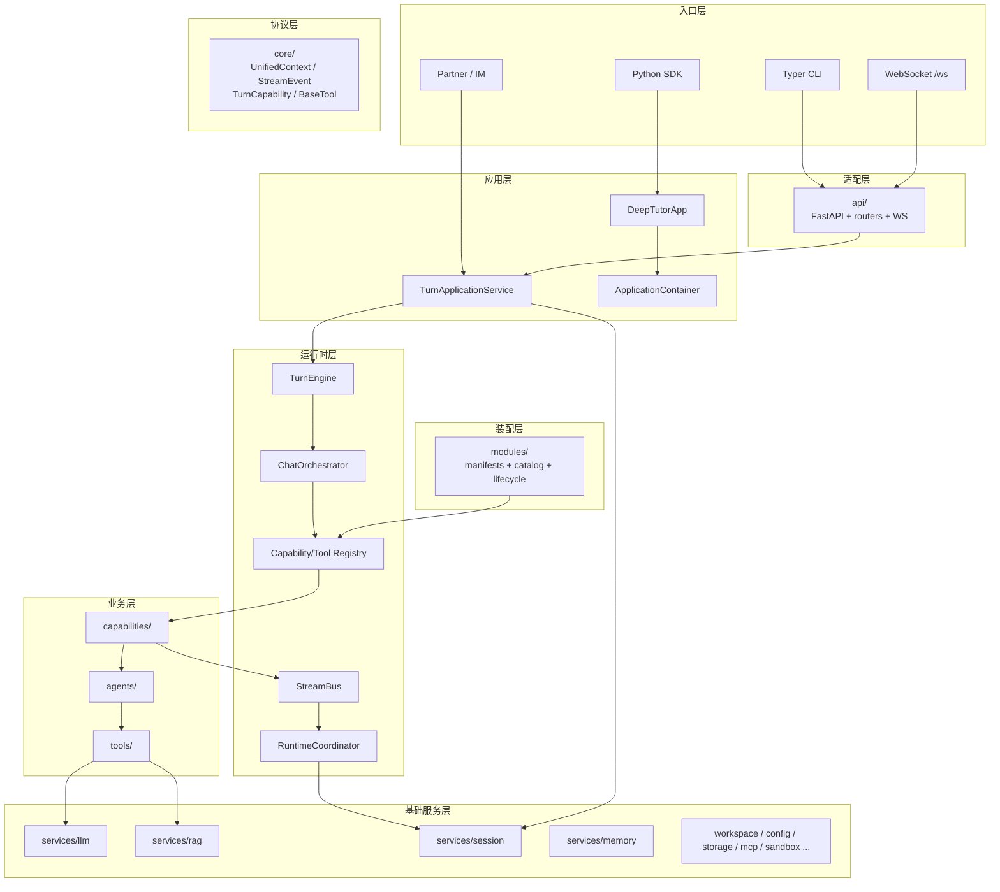
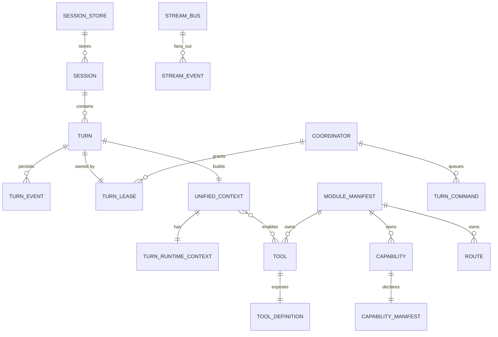
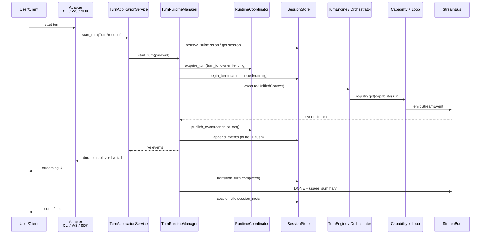

# DeepTutor 整体架构 · 代码阅读报告

> 按 `how-to-read-code` 工作流生成。  
> 结论标签：**[verified]** = 通过执行/调试/测试观察；**[static]** = 仅通过阅读源码、manifest、测试与 CI 配置推断。
>
> 本文聚焦“整体项目架构”。更细的工程结构、模块职责、场景链路分别见：
>
> - [`ENGINEERING_ARCHITECTURE.md`](./ENGINEERING_ARCHITECTURE.md)
> - [`CODE_FLOW_SCENARIOS.md`](./CODE_FLOW_SCENARIOS.md)
> - [`ARCHITECTURE.md`](./ARCHITECTURE.md)
> - [`PROJECT_GUIDE_PROFESSIONAL.md`](./PROJECT_GUIDE_PROFESSIONAL.md)

---

## 1. 范围与目的

### 1.1 目的（Phase 2）

回答一个整体问题：

> **DeepTutor 由哪些层、哪些模块组成？它们如何协作完成一次 turn？哪些是主线，哪些是支线？**

因此报告覆盖：

- 顶层分层与入口；
- turn 生命周期；
- Tool / Capability 两层模型；
- 模块 manifest 与发行装配；
- 领域模块与基础设施服务；
- 前端与桌面端；
- 核心数据结构；
- 设计取舍与技术债。

不在本次主线内：

- 每个 LLM provider 的具体实现；
- 每个 RAG pipeline 的算法细节；
- 每个前端页面的交互细节；
- 每个 IM 通道的协议细节；
- 实验性 TypeScript engine 的完整行为。

这些作为“黑盒”记录在第 5 节。

### 1.2 环境与是否运行（Phase 1）

- 仓库：`D:\workplaceForai\DeepTutor`
- 当前 shell：Git Bash on Windows
- **未启动完整应用**：当前 shell 中 `python` / `python3` / `py` 均不可用，只有 Node.js。
- 因此：
  - 无法执行 `deeptutor run/start`、`pytest`、`uvicorn`；
  - 无法获得真实 backtrace、运行时变量；
  - 架构与调用链结论均为 **[static]**。
- 已完成的替代验证：
  - 用 Node 解析 `deeptutor/modules/manifests/*.json`，核对能力、工具、路由、命令、导航贡献；
  - 用 Node 统计代码规模；
  - 读取 `AGENTS.md`、`docs-for-dev/*`、`pyproject.toml`、`.importlinter`、`.pre-commit-config.yaml`、`.github/workflows/tests.yml`、`web/package.json`、`apps/desktop/README.md`；
  - 读取入口、应用服务、turn runtime、orchestrator、registry、stream、session、coordination、capability/agent/tool 关键文件。
- 若后续能运行，建议优先验证：
  - `deeptutor run chat "..." --format json`
  - `python -m pytest tests/app tests/runtime/coordination -q`
  - `deeptutor doctor --format json`

### 1.3 代码规模（配置核对）

| 范围 | 行数 | 文件数 |
|---|---:|---:|
| Python 核心 + CLI（含包内测试） | **334,560** | 1,182 |
| Python 独立测试（`tests/` + 包内 learning tests） | **242,927** | 1,014 |
| Web TS/TSX | **335,799** | 1,523 |
| 其中 Web 测试 | ~61,300 | — |
| 其中生成 contracts | ~46,800 | — |
| TS chat engine | **5,185** | 29 |
| 桌面 shell JS/MJS | **2,268** | 34 |

粗略量级：总代码约 **90 万行**；去掉测试与生成代码，生产代码约 **60 万行**。行数含注释、docstring、类型标注，不是纯 SLOC。

---

## 2. 架构总览（横向，Phase 4）

### 2.1 一句话定位

DeepTutor 是一个 **agent-native 学习工作台**：

- 一个 Python 后端运行时；
- 一个 Next.js 前端；
- 一套模块化发行体系；
- 两层插件模型（Tool + Capability）；
- 多 provider / 多 RAG / 多解析 / 多 IM / 桌面端。

### 2.2 分层图



### 2.3 顶层组件职责

| 组件 | 位置 | 职责 |
|---|---|---|
| CLI | `deeptutor_cli/` | Typer 命令入口；`run`、`chat`、`kb`、`module`、`plugin`、`serve`、`start`、`doctor` |
| WebSocket 适配 | `deeptutor/api/routers/unified_ws.py` | `/ws` 命令协议、事件订阅/回放、取消、回复 |
| SDK | `deeptutor/app/facade.py` | `DeepTutorApp` 门面；workspace、turn、订阅 |
| 应用服务 | `deeptutor/app/service.py` | 持久化 admission、幂等、订阅回放、取消、回复 |
| Turn 运行时 | `deeptutor/services/session/turns/` | 请求准备、上下文装配、租约、执行、终态、标题 |
| 执行引擎 | `deeptutor/runtime/turn_engine.py` | 懒加载 orchestrator，执行 `UnifiedContext` |
| 路由编排 | `deeptutor/runtime/orchestrator.py` | 选 capability、StreamBus、异常/终态/usage |
| 注册表 | `deeptutor/runtime/registry/` | capability/tool 懒加载、别名、deferred、插件 |
| 业务层 | `agents/`、`capabilities/`、`tools/` | agent loop、能力管线、模型可选工具 |
| 协议层 | `deeptutor/core/` | `UnifiedContext`、`StreamEvent`、能力/工具协议 |
| 领域层 | `learning/`、`reading/`、`book/`、`knowledge/`、`partners/`、`notes/`、`co_writer/`、`visualizers/`、`video_learning/` | 学习、阅读、书籍、知识库、伴侣、笔记、协作写作、可视化、视频学习 |
| 基础服务 | `deeptutor/services/` | LLM、RAG、会话、记忆、工作区、存储、MCP、沙箱、解析、Prompt |
| 装配层 | `deeptutor/modules/` | manifest catalog、模块生命周期、installed/enabled/ready |
| 前端 | `web/` | Next.js App Router、feature 切片、共享 transport、生成 contracts |
| 桌面 | `apps/desktop/` | Electron shell + bundled Python/Node/Next |

### 2.4 模块化发行

`deeptutor/modules/manifests/*.json` 是权威目录，声明：

- `paths`：模块拥有的源码路径；
- `requires` / `optional`：模块依赖；
- `capabilities` / `loops` / `tools`：贡献；
- `routes`：FastAPI router 引用、前缀、授权策略；
- `commands`、`navigation`：CLI 与前端导航；
- `requirements`、`executables`：依赖与系统工具。

26 个模块：`core`、`server`、`web`、`solve`、`questions`、`research`、`visualize`、`renderer-manim`、`video-lesson`、`audio-overview`、`knowledge`、`parsing`、`parser-markitdown`、`parser-docling`、`parser-pymupdf4llm`、`parser-liteparse`、`reading`、`mastery`、`books`、`memory`、`notebook`、`co-writer`、`calendar`、`partners`、`providers` 等。

三态：**installed**（distribution 是否安装）、**enabled**（`data/system/modules.json`）、**ready**（依赖/版本/可执行文件/必需模块）。

---

## 3. 核心数据结构与关系（Phase 7）

| 结构 | 位置 | 创建/持有/修改 | 作用 |
|---|---|---|---|
| `UnifiedContext` | `core/context.py:92` | 上下文装配器创建；`TurnEngine`/`Orchestrator`/Capability 持有；Capability/loop 修改 | 一个 turn 的全部输入与运行时状态 |
| `TurnRuntimeContext` | `core/context.py:50` | 上下文装配器创建 | 不可序列化回调、模型历史、workspace 快照、`ask_user` 通道 |
| `WorkspaceRuntimeContext` | `core/context.py:34` | workspace 解析创建 | 冻结本次 turn 的 workspace 根/输出目录/安全级别 |
| `Attachment` | `core/context.py:16` | 请求解析创建 | 图片/文件/PDF 附件 |
| `InteractionState` | `core/context.py:74` | 上下文装配器创建 | `end_loop`、用户答案 |
| `CapabilityOutput` | `core/context.py:82` | Capability 写入 | 统一终态输出与事件元数据 |
| `StreamEvent` | `core/stream.py:37` | Capability/Tool/Orchestrator 创建；运行时补 `seq`/`turn_id` | 15 种事件：stage/thinking/content/tool/result/error/done 等 |
| `TurnRequest` | `app/contracts.py` | 适配器创建；应用服务验证 | 跨入口统一请求契约 |
| `TurnLease` | `runtime/coordination/types.py:44` | Coordinator 创建；Executor 持有/续租 | turn 所有权与 fencing |
| `TurnCommand` | `coordination/types.py:60` | 适配器/应用服务创建 | cancel/submit_user_reply/user_input |
| `_TurnExecution` | `services/session/_turn_runtime_shared.py:1422` | RequestPreparer 创建；RuntimeManager 持有 | 进程内执行记录：task/subscribers/events/lease |
| `SessionStoreProtocol` | `services/session/protocol.py:149` | `get_session_store()` 创建 | session/message/turn/event 统一协议 |
| `ToolDefinition` / `BaseTool` | `core/tool_protocol.py:77` | 工具实现 | 工具 schema 与执行契约 |
| `CapabilityManifest` / `TurnCapability` | `core/capability_protocol.py:33` / `:46` | 能力实现 | 能力元数据与 `run(context, stream)` |
| 模块 manifest | `modules/manifests/*.json` | 模块作者 | 贡献归属/依赖/路由/命令/导航 |
| Memory L1/L2/L3 | `services/memory/` | `MemoryStore` / consolidator | 原始轨迹 → 事实 → 综合记忆 |



> 概念关系，不是数据库物理 schema。实际持久化在 `services/session/sqlite_store.py` / `pocketbase_store.py`。

生命周期要点：

1. `UnifiedContext` 是“每 turn 一次”的对象，混合可序列化输入与不可序列化运行时。
2. `TurnLease` 是 turn 所有权的唯一证据；不能用 `updated_at` 或事件是否安静来判断活性。
3. `StreamEvent.seq` 是回放契约；由协调器统一分配，不能每个进程从 1 重新开始。
4. 终态先落库，DONE 后可见；DONE 后还可能有 `session_meta` 标题尾巴。
5. `StreamBus` 是进程内扇出，durable replay 依赖 event journal + session store。

---

## 4. 纵向分析：一次 `chat` turn（Phase 5）

> 本报告未运行应用，无法给出真实 backtrace；以下是 **[static]** 调用路径。

### 4.1 时序图



### 4.2 静态调用路径

```text
CLI / WS / SDK
  → deeptutor/app/facade.py: DeepTutorApp.start_turn
    → deeptutor/app/service.py: TurnApplicationService.start_turn
      → deeptutor/services/session/turns/request_preparer.py: TurnRequestPreparer
        → runtime/coordination: acquire_turn
        → services/session: begin_turn
        → deeptutor/services/session/turns/executor.py: TurnExecutor
          → deeptutor/runtime/turn_engine.py: TurnEngine.execute
            → deeptutor/runtime/orchestrator.py: ChatOrchestrator.handle
              → runtime/registry/capability_registry.py: get
              → agents/chat/capability.py: ChatCapability.run
                → agents/chat/agentic_pipeline.py: AgenticChatPipeline
                  → agents/loop/pipeline.py: AgenticLoopPipeline
                    → agents/loop/agent_loop.py / runtime/agentic
```

### 4.3 关键步骤

1. **Admission**
   - `TurnApplicationService.start_turn()`（`app/service.py:113`）验证 `TurnRequest`、解析 workspace、幂等提交、调用 runtime。
2. **请求准备与租约**
   - `TurnRequestPreparer` 解析 session/capability/workspace/persona/LLM/KB/附件/memory；
   - `coordinator.acquire_turn()`（约 `request_preparer.py:795`）；
   - `store.begin_turn()`（约 `:830`）；
   - 创建 `_TurnExecution`，注册 ownership marker。
3. **上下文装配**
   - `TurnExecutor`（`executor.py:69`）读取历史、memory、sources、attachments、book/reading/mastery 上下文；
   - 组装 `UnifiedContext`；
   - `turn_engine.execute(context)`（约 `:1079`）。
4. **执行与路由**
   - `TurnEngine.execute()`（`runtime/turn_engine.py:17`）→ `ChatOrchestrator.handle()`（`orchestrator.py:64`）；
   - 校验 KB 模块、选择 `HandoffCapability` 或 `active_capability or "chat"`；
   - 创建 `StreamBus`，独立 task 执行 `capability.run(context, bus)`。
5. **Agent Loop**
   - `AgenticLoopPipeline.run()`（`agents/loop/pipeline.py:403`）；
   - `AgentLoop.run()`（`agents/loop/agent_loop.py:208`）；
   - 工具面由 `_compose_enabled_tools()`（`:782`）+ `tool_composition.py` 决定；
   - 工具派发 `runtime/agentic/tool_dispatch.py:127` / `:666`。
6. **事件持久化**
   - `_publish_live_event()`（`services/session/turns/lifecycle.py:681`）补 id、协调器 `publish_event()` 分配 `seq`、追加 `execution.events`、flush 到 store、推给 live subscriber。
7. **终态**
   - `TurnExecutor` flush → `transition_turn()` → 发布 DONE → `SessionTitleService` 生成 `session_meta` → 最终 flush。
8. **回放**
   - `TurnApplicationService.subscribe_turn()`（`app/service.py:248`）先 durable replay 再 live tail；DONE 尾巴/终态合成规则。

### 4.4 核心 invariants

1. 先拿 lease，再插 turn 行。
2. 事件先进入持久化/回放路径，再交付消费者。
3. terminal 行先落库，DONE 后可见。
4. lease 是唯一活性证据；`ask_user` 暂停时事件安静是正常的。
5. `seq` 属于公共契约；不能每个进程从 1 重新开始。
6. 取消/worker 丢失必须保留已产出的部分结果。

---

## 5. 黑盒（Phase 3，有意未展开）

| 接口/模块 | 输入 | 输出/效果 | 为什么不展开 |
|---|---|---|---|
| `services/llm/provider_core/*`、`provider_factory.py` | 模型配置、API key、wire format | provider client、流式 completion、usage | 供应商适配细节多；本次只关心“能力如何拿 LLM” |
| `services/rag/pipelines/*` | KB 名称、文件、查询 | 索引、检索结果、引用 | RAG 是独立子系统；只保留 `RAGService` 入口 |
| `services/parsing/*`、`parser-*` 模块 | 文档路径/字节 | 提取文本、图片、结构 | 解析器实现与具体库强耦合 |
| `plugins/runtime.py`、`lifecycle.py` | 插件 manifest、审批、worker | 插件 capability/tool/frontend | 第三方插件协议复杂 |
| `services/mcp/*` | MCP 配置、OAuth、secrets | MCP 工具发现与调用 | 外部协议集成 |
| `services/cli_apps/*` | CLI app manifest、安装状态 | `exec` 可用的命令 | 外部工具安装器 |
| `partners/channels/*` | IM 消息、附件 | 统一 turn 请求 | 通道适配器多 |
| `apps/desktop/src/*`、`platforms/*` | 打包运行时 | Electron 启动/关闭/签名 | 桌面发布独立工程 |
| `packages/chat-engine/src/*`、`runtime/ts_engine/*` | 种子上下文、scoped ports | TS 原生 agent 执行 | 实验性路径；默认 Python 调度器才是主链路 |
| `web/features/*` 各 feature 内部 | contracts、store、transport | React UI | 页面级细节 |

---

## 6. 主动提问与设计取舍（Phase 8）

### 6.1 为什么这样设计

1. **先做持久化应用服务，再做 turn 执行**
   - 三个入口共享 admission、幂等、回放、取消、恢复；
   - 浏览器断开不等于 turn 失败；`TurnLease` 是唯一活性证据；
   - 代价是链路更长。

2. **Tool / Capability 两层**
   - Tool 适合模型自选单步操作；
   - Capability 适合阶段化、专用 prompt/预算/工具面的完整 turn；
   - 避免把所有模式塞进一个巨大 chat prompt。

3. **manifest 驱动模块**
   - 同一 JSON 服务源码归属、wheel 打包、运行时注册、API 路由、CLI 命令、前端导航；
   - 读取 manifest 不 import feature，保证 core 安装不会因可选依赖缺失而启动失败；
   - 代价是 manifest 必须无环、无重复归属、路径合法。

4. **StreamBus + durable seq**
   - 进程内 fan-out 负责低延迟；持久化 journal 负责重连/重启/多 worker；
   - `seq` 由协调器统一分配；
   - 代价是事件协议和 sequence 语义成为公共契约。

5. **import-linter + 架构测试**
   - core 不能反向依赖 app/api/runtime/services；
   - runtime/services/... 不能 import api；
   - app 不能 import api。

### 6.2 如果是我，会怎样不同

- **收敛 turn 运行时的“切片 + 兼容层”**：`TurnRuntimeManager` 组合 6 个 mixin，`_turn_runtime_shared.py` 仍有约 1,700 行兼容值层；`executor.py` 约 1,554 行、`lifecycle.py` 约 821 行。若重设计，我会用显式 `TurnState` 状态机 + 明确的 admission/context/journal/terminal/title 接口，减少 mixin 隐式依赖。
- **统一 capability/tool 协议命名**：`core/capability_protocol.py` 与 `capabilities/protocol.py` 名字相近；应在文档/docstring 中明确“core 是稳定协议，capabilities 是 loop 扩展协议”，或进一步合并。
- **减少兼容 facade**：`CapabilityRegistry` 是 `CapabilityCatalog` 的兼容外观；长期应明确唯一权威，避免两套注册路径漂移。
- **把“可用性”前移为显式 contract**：turn 开始时生成 `TurnCapabilityPlan`（能力 + 工具 + 资源权限 + 模块状态），执行阶段只消费计划，减少“发现时允许、派发时又拒绝”。

### 6.3 可疑点/技术债

- `services/session/sqlite_store.py` 约 4,852 行；`turns/executor.py` 约 1,554；`turns/lifecycle.py` 约 821；`turns/request_preparer.py` 约 1,266；`_turn_runtime_shared.py` 约 1,763；`agents/loop/pipeline.py` 约 2,057；`agent_loop.py` 约 1,478。可考虑按状态/聚合拆分。
- 双实现路径：SQLite/PocketBase、Python scheduler/TypeScript engine，带来条件分支与兼容代码。
- 生成 contracts 入库：`web/contracts` 约 46.8k 行；必要但更适合作为构建产物管理。
- 兼容层：`CapabilityRegistry` vs `CapabilityCatalog`、旧 `deeptutor.plugins` 入口、legacy chat migration、v1 memory migration。
- 代码量大主要来自产品宽度（11 能力、26 模块、多 provider/RAG/IM、完整前端、桌面、30 万行测试），不完全是重复代码；但上述热点确实有优化空间。

---

## 7. 后续阅读建议（Phase 9）

- [ ] **跑通一次真实 turn**：准备 Python 环境后，在 `TurnApplicationService.start_turn`、`TurnExecutor` 调 `turn_engine.execute`、`ChatOrchestrator.handle` 下断点，观察 `UnifiedContext`、lease、事件 seq。
- [ ] **打开 RAG 黑盒**：读 `services/rag/factory.py`、`services/rag/pipelines/*`、`knowledge/indexing_run.py`。
- [ ] **打开 provider 黑盒**：读 `services/llm/provider_factory.py`、`provider_core/`、`request_cache.py`、`usage.py`。
- [ ] **验证多 worker 协调**：用 Redis coordinator 跑两个 worker，观察 lease/fencing/`worker_lost`。
- [ ] **读前端 chat transport**：`web/features/chat/transport`、`web/lib/reconnecting-websocket.ts`、`web/lib/stream.ts`、`web/lib/turn-reconcile.ts`。
- [ ] **读插件/伙伴链路**：`plugins/runtime.py`、`partners/channels`、`services/partners`。
- [ ] **读实验性 TS engine**：`packages/chat-engine/README.md` + `runtime/ts_engine/`。
- [ ] **跑 CI 等价检查**：`python -m pytest tests deeptutor/learning/tests`、`lint-imports`、`python scripts/check_architecture.py`、`(cd web && npm run check:fast)`。

---

## 8. 附录：模块地图

### 8.1 后端包

| 包 | 职责 |
|---|---|
| `app/` | `TurnApplicationService`、`DeepTutorApp`、依赖容器、请求契约 |
| `api/` | FastAPI 应用、50 个 router、`/ws`、路由懒加载、鉴权 |
| `runtime/` | `TurnEngine`、`ChatOrchestrator`、`StreamBus`、协调器、registry、agentic、launcher、isolated worker |
| `core/` | 协议与值对象 |
| `agents/` | 通用 agent loop、各模式 agent |
| `capabilities/` | 独立 turn 能力与 loop 扩展 |
| `tools/` | 模型可调用工具 |
| `services/` | LLM、RAG、session、memory、workspace、config、MCP、sandbox、parsing 等 |
| `knowledge/` | KB 管理、索引运行、进度 |
| `learning/` | mastery、grading、assessment、scheduler |
| `reading/` | 阅读器后台 |
| `book/` | Book 引擎/编译器 |
| `partners/` | Partner/IM 运行时 |
| `plugins/` | 第三方插件 |
| `multi_user/` | 多用户/权限/workspace |
| `notes/`、`co_writer/`、`visualizers/`、`video_learning/` | 领域功能 |
| `modules/` | manifest catalog/lifecycle |

### 8.2 前端

| 目录 | 职责 |
|---|---|
| `web/app/` | App Router 页面 |
| `web/features/` | chat、settings、notes、calendar、knowledge、co-writer、multi-user、capabilities、runtime-status、tasks、ui-layout |
| `web/components/` | 共享 UI |
| `web/lib/` | API/WS/stream/reconcile/阅读器/文件 |
| `web/shared/` | api/auth/storage/ui 原语 |
| `web/contracts/` | 生成契约 |
| `web/proxy.ts` | API/WS rewrite + auth gate |

### 8.3 桌面/工具链

| 目录 | 职责 |
|---|---|
| `apps/desktop/` | Electron shell + Mac/Windows 打包 |
| `packages/chat-engine/` | 实验性 TS engine |
| `scripts/` | 构建模块、同步 requirements、生成 contracts、架构/卫生检查 |
| `requirements/` | 生成依赖 |
| `tests/` | Python 测试 |
| `docs-for-dev/` | 开发手册 |

---

## 9. 关键文件索引

| 主题 | 入口 |
|---|---|
| CLI | `deeptutor_cli/main.py` |
| SDK | `deeptutor/app/facade.py` |
| 应用服务 | `deeptutor/app/service.py` |
| 依赖容器 | `deeptutor/app/container.py` |
| Turn 运行时 | `deeptutor/services/session/turn_runtime.py` |
| 请求准备 | `deeptutor/services/session/turns/request_preparer.py` |
| Turn 执行 | `deeptutor/services/session/turns/executor.py` |
| Turn 生命周期/事件 | `deeptutor/services/session/turns/lifecycle.py` |
| 会话存储协议 | `deeptutor/services/session/protocol.py` |
| SQLite 存储 | `deeptutor/services/session/sqlite_store.py` |
| Turn 引擎 | `deeptutor/runtime/turn_engine.py` |
| Orchestrator | `deeptutor/runtime/orchestrator.py` |
| 能力注册 | `deeptutor/runtime/registry/capability_registry.py` |
| 工具注册 | `deeptutor/runtime/registry/tool_registry.py` |
| 能力/工具协议 | `deeptutor/core/capability_protocol.py`、`core/tool_protocol.py` |
| 流式事件 | `deeptutor/core/stream.py`、`runtime/stream_bus.py` |
| 协调器 | `deeptutor/runtime/coordination/` |
| 恢复 | `deeptutor/runtime/coordination/recovery.py` |
| Agent loop | `deeptutor/agents/loop/pipeline.py`、`agents/loop/agent_loop.py` |
| 工具组合 | `deeptutor/agents/_shared/tool_composition.py` |
| 能力结果 | `deeptutor/agents/_shared/capability_result.py` |
| 模块目录 | `deeptutor/modules/catalog.py`、`modules/manifests/*.json` |
| RAG | `deeptutor/services/rag/service.py`、`services/rag/pipelines/` |
| Memory | `deeptutor/services/memory/` |
| LLM | `deeptutor/services/llm/provider_factory.py`、`provider_core/` |
| API | `deeptutor/api/main.py`、`api/routers/unified_ws.py` |
| 前端 | `web/app/`、`web/features/`、`web/shared/`、`web/contracts/` |
| 前端代理 | `web/proxy.ts` |
| 前端依赖规则 | `web/.dependency-cruiser.cjs` |
| 桌面 | `apps/desktop/` |
| 实验 TS 引擎 | `packages/chat-engine/`、`deeptutor/runtime/ts_engine/` |

---

## 10. 结论

DeepTutor 是一个：

> **以持久化 turn 为中心、以 Tool/Capability 两层插件为扩展面、以模块 manifest 为装配契约、以多 provider/RAG/解析/IM 为基础设施、以 Next.js + Electron 为交互层的 agent-native 学习平台。**

四条主线：

1. **入口统一**：CLI / WS / SDK / Partner 都走 `TurnApplicationService`（Partner 直接走 `TurnEngine`，但复用同一执行层）；
2. **turn 有生命周期**：lease → durable row → events → terminal → replay；
3. **能力拥有 turn，工具服务循环**：Capability 决定阶段与提示词，Tool 由模型按需选择；
4. **装配与实现分离**：manifest 决定“装什么、开什么、暴露什么”，代码只在启用后加载。

本次报告是 **[static]** 结论；下一步最有价值的验证是：**跑通一次真实 turn，并在 admission / lease / orchestrator / event flush 四处下断点**。
