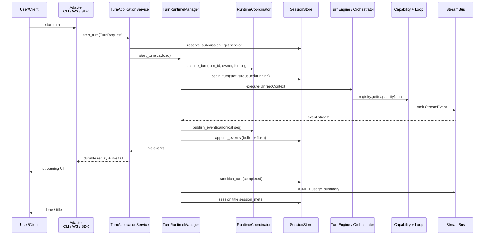

# DeepTutor 代码链路：场景化解析

> 本文按“不同使用场景”整理从入口到关键实现的代码链路。  
> 结论均为 **[static]**：基于当前 checkout 的源码、manifest、路由与测试整理，未在本地启动完整应用。行号以当前版本为准，后续代码变动可能偏移。
>
> 相关文档：
> - [`架构阅读报告.md`](./架构阅读报告.md) — 架构阅读报告
> - [`工程架构与模块职责.md`](./工程架构与模块职责.md) — 工程结构与模块职责
> - [`项目解析_专业版.md`](./项目解析_专业版.md) — 专业版项目解析

---

## 0. 通用主干：所有 turn 共享的链路

无论入口是 CLI、WebSocket、SDK，还是 Partner，普通 turn 都经过这套主干：



### 0.1 通用步骤

1. **入口适配**
   - CLI：`deeptutor_cli/main.py` / `deeptutor_cli/chat.py`
   - WebSocket：`deeptutor/api/routers/unified_ws.py`
   - SDK：`deeptutor/app/facade.py`
   - Partner：`deeptutor/services/partners/runtime.py`

2. **应用层 admission**
   - `TurnApplicationService.start_turn()`（`deeptutor/app/service.py:113`）
   - workspace context、store/runtime 解析、`reserve_submission` 幂等、`ActiveTurnConflict` reclaim、session preferences 更新。

3. **请求准备与租约**
   - `TurnRequestPreparer`（`deeptutor/services/session/turns/request_preparer.py`）
   - 解析 session/capability/workspace/persona/LLM/KB/附件/memory；
   - `coordinator.acquire_turn()`（约 `:795`）；
   - `store.begin_turn()`（约 `:830`）；
   - 创建 `_TurnExecution`，注册 ownership marker；
   - mastery turn 可能额外获取 path lease。

4. **上下文装配**
   - `TurnExecutor`（`deeptutor/services/session/turns/executor.py:69`）
   - 读取历史、memory、learning journal、persona、skills、source manifest、附件、引用、book/reading/mastery 上下文；
   - 组装 `UnifiedContext`（`deeptutor/core/context.py:92`）；
   - 调用 `self.turn_engine.execute(context)`（约 `executor.py:1079`）。

5. **执行引擎**
   - `TurnEngine.execute()`（`deeptutor/runtime/turn_engine.py:17`）
   - `ChatOrchestrator.handle()`（`deeptutor/runtime/orchestrator.py:64`）
   - 校验 KB 模块、选择 `HandoffCapability` 或 `active_capability or "chat"`、创建 `StreamBus`、执行 capability、发 DONE/usage。

6. **能力与 Agent Loop**
   - Capability 的 `run(context, stream)`；
   - 多数 chat-like 能力进入 `AgenticChatPipeline` → `AgenticLoopPipeline.run()`（`deeptutor/agents/loop/pipeline.py:403`）；
   - 具体 agent loop 在 `AgentLoop.run()`（`deeptutor/agents/loop/agent_loop.py:208`）；
   - LLM 轮次、工具组合、工具派发、上下文预算、`ask_user` 暂停/恢复。

7. **工具执行**
   - `_compose_enabled_tools()`（`pipeline.py:782`）决定工具面；
   - `runtime/agentic/tool_dispatch.py:127` `dispatch_tool_calls()` / `:666` `execute_tool_call()`；
   - 工具实现 `BaseTool.execute()`（`core/tool_protocol.py`）；
   - MCP/插件/CLI deferred 工具走各自 loader。

8. **事件持久化**
   - `_publish_live_event()`（`deeptutor/services/session/turns/lifecycle.py:681`）
   - 补 `session_id`/`turn_id` → coordinator `publish_event()` 分配 `seq` → 追加 `execution.events` → DONE/积压≥25 或 0.25s 延迟 flush → 推给 live subscriber。

9. **终态**
   - `TurnExecutor` flush → `transition_turn()`（completed/failed/cancelled）→ 发布 DONE → `SessionTitleService` 生成 `session_meta` → 最终 flush。
   - 异常/取消/lease 丢失分别走 `error`、`CancelledError`、`TurnRecoveryService`。

10. **回放**
    - `TurnApplicationService.subscribe_turn()`（`app/service.py:248`）
    - 先 `store.get_events(after_seq)` durable replay，再 `coordinator.read_events(after_seq)` live tail；
    - DONE 后可能等标题尾巴；终态行无 DONE 时合成 `error`+`done`。

---

## 1. 场景 A：CLI 单次执行 `deeptutor run chat`

### 入口

```bash
deeptutor run chat "解释傅里叶变换"
deeptutor run deep_solve "解方程 x^2=4" --kb my-kb
```

### 代码链路

1. `deeptutor_cli/main.py:77` `run_capability()`
   - Typer 解析 `capability`、`message`、`--session`、`--workspace`、`--tool`、`--kb`、`--language`、`--config`、`--format`。
2. `deeptutor_cli/common.py:831` `build_turn_request()`
   - 组装 `TurnRequest`（content、capability、session、tools、knowledge_bases、language、config、notebook/history refs）。
3. `deeptutor_cli/main.py:119` 创建 `DeepTutorApp(workspace_id=...)`（或默认实例）。
4. `deeptutor_cli/common.py:129` `run_turn_and_render()`
   - `session, turn = await app.start_turn(request)`（`:135`）。
5. `deeptutor/app/facade.py:129` `DeepTutorApp.start_turn()`
   - `container.start()`；
   - `resolve_capability()`（别名 → 正式名）；
   - 解析 workspace context；
   - 调 `self.turns.start_turn(...)`。
6. 进入通用主干第 2–8 步。
7. 输出方式：
   - `--format json`：`deeptutor_cli/common.py:185` `stream_turn_as_json()` → `app.stream_turn(turn_id)` → `subscribe_turn()` → 一行一个 JSON 事件；
   - 默认 rich：`render_turn_stream()` → 渲染 content/thinking/tool/result/error，Ctrl-C 取消 turn；
   - `ask_user` 在 JSON 模式下自动回空字符串，避免 headless 卡住。

### 交互式 REPL

1. `deeptutor_cli/chat.py:45` `chat()` 建 `ChatState`。
2. 循环读取输入 → `run_turn_and_render()`。
3. `/regenerate` / `/retry` → `deeptutor_cli/common.py:164` `regenerate_and_render()` → `facade.py:200` `regenerate_last_turn()`。
4. `/show` 读取进程级 `tool_results` ring buffer。

### 排查点

- 是否命中 `reserve_submission` 幂等；
- `TurnRequest.capability` 是否解析成 manifest 里的正式名；
- `fmt=json` 时 `ask_user` 是否自动回空导致行为差异；
- CLI 直接调用 SDK，绕过 WS；因此 CLI 的 `ask_user` / 取消路径与 Web 不完全相同。

---

## 2. 场景 B：WebSocket 前端 chat turn

### 入口

前端通过 `web/proxy.ts` 把 `/ws/*` rewrite 到后端，然后连接 `/ws`。

### 代码链路

1. `deeptutor/api/routers/unified_ws.py:43` `unified_websocket()`
   - `ws_require_auth()` → `ws.accept()`；
   - 通过 `application_container` 获取 `container.turns`。
2. 接收 JSON 命令，校验 `protocol_version`，用 `ClientCommand` 校验形状。
3. `msg_type in {"message", "start_turn"}`（`:220`）
   - `turns.start_turn(payload)`；
   - `subscribe_turn(turn["id"])`（`:237`）。
4. `subscribe_turn()`（`:140`）
   - 子任务 `_forward()` 调用 `turns.subscribe_turn(turn_id, after_seq)`；
   - 每个事件 `safe_send()`。
5. 前端断线 → 重新连接 → 发送：
   - `subscribe_turn` / `resume_from`（`:244`）带 `after_seq`；
   - 或 `subscribe_session`（`:255`）订阅当前 session 的 active turn。
6. 其他命令：
   - `cancel_turn`（`:288`）→ `turns.cancel_turn_and_wait()`；
   - `submit_user_reply`（`:308`）→ `turns.submit_user_reply()`；
   - `regenerate`（`:331`）→ `turns.regenerate_last_turn()`；
   - `user_input`（`:357`）→ `turns.submit_user_input()`；
   - `check_active_turn`、`unsubscribe`、`ping`。
7. 断开连接：`WebSocketDisconnect` → 取消所有 subscription task；**turn 本身不会被取消**。

### 关键事件

- `SESSION`（orchestrator 发）；
- `CONTENT` / `THINKING` / `TOOL_CALL` / `TOOL_RESULT` / `PROGRESS` / `SOURCES`；
- `RESULT`（能力终态 envelope）；
- `ERROR`（terminal error）；
- `DONE`（带 `status`、`usage_summary`）；
- `SESSION_META`（DONE 后标题）。

### 排查点

- `after_seq` 是否连续；
- DONE 后是否还有 `session_meta` 尾巴；
- 客户端断开是否误判 turn 失败；
- `cancel_turn` ACK 是否在 lease 释放后才返回。

---

## 3. 场景 C：Python SDK

### 入口

```python
app = DeepTutorApp(workspace_id="...")
session, turn = await app.start_turn(TurnRequest(...))
async for event in app.stream_turn(turn["id"], after_seq=0):
    ...
```

### 代码链路

1. `deeptutor/app/facade.py:129` `DeepTutorApp.start_turn()`
   - `container.start()`；
   - `resolve_capability()`；
   - `workspace_context()`；
   - `self.turns.start_turn(...)`。
2. `deeptutor/app/facade.py:151` `stream_turn()`
   - 恢复 workspace context；
   - `self.turns.subscribe_turn(turn_id, after_seq)`。
3. `facade.py:169` `cancel_turn()` → `TurnApplicationService.cancel_turn()`。
4. `facade.py:185` `submit_user_reply()` → `TurnApplicationService.submit_user_reply()`。
5. `facade.py:200` `regenerate_last_turn()` → `TurnApplicationService.regenerate_last_turn()`。

### 与 CLI/WS 的差异

- SDK 在进程内直接调用应用服务，不经过 HTTP/WS；
- workspace 绑定通过 `self._turn_workspaces[turn_id]` 维护；
- `container.start()` 保证 store/runtime/registry 只初始化一次。

---

## 4. 场景 D：chat-loop 变体（ask_questions / deep_solve / immersive_reading）

这些能力的共同点：**capability 只负责“标记模式 + 选择 loop profile”，真正的循环由共享 agent loop 执行。**

### 4.1 `ask_questions`

1. `ChatOrchestrator.handle()` → `AskQuestionsCapability.run()`（`capabilities/ask_questions/capability.py:22`）。
2. 设置 `context.metadata["ask_questions_mode"] = True`。
3. 构造 `AgenticChatPipeline(initial_tool_choice="ask_user")`。
4. `AgenticLoopPipeline.run()` → `AgentLoop.run()`。
5. 第一轮强制 `ask_user`，工具 `AskUserTool.execute()`（`tools/builtin/__init__.py:1863`）发 `WAIT_FOR_INPUT`。
6. 用户回复 → `submit_user_reply` → 命令队列 → loop 继续。

### 4.2 `deep_solve`

1. `DeepSolveCapability.run()`（`capabilities/solve/capability.py:65`）。
2. 设置 `solve_mode`、`solve_session_id`。
3. `get_solve_params()` 读取 `max_rounds` / `max_replans` / temperature / max_tokens。
4. 构造 `AgenticChatPipeline`。
5. `SolveLoopCapability`（`capabilities/solve/loop.py`）挂载 `solve_plan` / `solve_finish_step` / `solve_replan` 与 curated builtins。
6. `SolveSession`（`capabilities/solve/session.py`）保存 plan、per-step gate、replan budget。
7. 模型负责规划/求解；确定性 spine 由工具读写。

### 4.3 `immersive_reading`

1. `ImmersiveReadingCapability.run()`（`capabilities/reading/mode.py:44`）。
2. `resolve_material_id(context)`；设置 `MATERIAL_ID_KEY` + `MODE_KEY`。
3. 构造 `AgenticChatPipeline`。
4. `ReadingCapability`（`capabilities/reading/capability.py:112`）挂载 reading tools、绑定 open material、注入 reading playbook、执行 deterministic locate pre-pass。
5. 无 material 时退化为普通 chat turn。

### 4.4 `handoff`

1. `ChatOrchestrator.handle()` 检测 `context.runtime.answer_by`。
2. 选择 `HandoffCapability`（`capabilities/handoff/capability.py:218`），不走 registry。
3. 由 Partner/外部 agent 代答。

### 排查点

- capability 的 `run()` 是否只做标记，还是自己实现了管线；
- loop capability 是否挂载了正确工具；
- `ask_user` 是否在 CLI JSON 模式下被自动回答；
- `deep_solve` 的 replan budget 是否写入 `context.metadata`。

---

## 5. 场景 E：`deep_research`

### 入口

`ChatOrchestrator` → `DeepResearchCapability.run()`（`agents/research/capability.py:37`）。

### 代码链路

1. 读取第一个 KB：`context.knowledge_bases[0]`（可选）。
2. `validate_research_request_config(context.config_overrides)`。
3. `enabled_tools = context.enabled_tools`。
4. `build_research_runtime_config(base_config, request_config, kb_name)`。
5. **两阶段大纲流程**：
   - 第一次调用没有 `confirmed_outline` → pipeline 返回 `outline_preview` 并退出；
   - 前端展示大纲编辑器；
   - 用户确认后第二次调用带 `confirmed_outline` → 构造 `SubTopicItem` 列表。
6. 构造 `ResearchPipeline(language, runtime_config, kb_name, enabled_tools)`。
7. `ResearchPipeline.run(context, topic, confirmed_outline, attachments, stream)`（`agents/research/pipeline.py:527`）。
8. Pipeline 内部：
   - rephrase（mini agentic loop，可 `ask_user`）；
   - decompose；
   - 每个 block 的 research loop（`THINK` / `TOOL` / `APPEND` / `FINISH`）；
   - queue scheduler；
   - iterative reporting。
9. 若返回 `outline_preview`，`stream.result()` 带 `research_config` 退出。
10. 否则由 pipeline 自行发 content/result。

### 关键事件

- `outline_preview`（顶层字段，前端读取 `event.metadata.outline_preview`）；
- `research_config`（mode/depth/manual_subtopics/manual_max_iterations）；
- stage 事件：rephrasing → decomposing → researching → reporting。

### 排查点

- 第一次/第二次调用是否带同一个 `confirmed_outline`；
- `enabled_tools` 是否从 composer 正确传入；
- KB 未选择时 research 是否按无 KB 模式运行；
- `research_audit` / `paper_search` 等工具是否已挂载。

---

## 6. 场景 F：`deep_question`

### 入口

`DeepQuestionCapability.run()`（`agents/question/capability.py:29`）。

### 分支

#### F1. followup

1. `context.metadata["question_followup_context"]` 有 `question` → 走 `FollowupAgent`。
2. 构造 `FollowupAgent` + `UsageTracker`。
3. `agent.process(user_message, question_context, history_context, attachments)`。
4. `stream.content(answer)` → `emit_capability_result(...)`。

#### F2. custom

1. `mode == "custom"`（默认）。
2. 校验 `topic` 非空；否则 `stream.error(topic_required)`。
3. `load_session_quiz_history(session_id)`。
4. `build_question_runtime_config()`。
5. 构造 `QuestionPipeline(language, kb_name, enabled_tools, runtime_config)`。
6. `pipeline.run(context, user_message, num_questions, difficulty, question_types, per_type_counts, conversation_context, attachments, quiz_history, stream)`（`agents/question/pipeline.py:457`）。
7. Pipeline 内部：explore → plan → per-question quiz loop。

#### F3. mimic

1. 从 `overrides` 取 `paper_path` / `max_questions`。
2. 找 PDF 附件；有则写临时文件 → `parse_exam_paper_to_templates()`（MinerU）→ `templates_override`。
3. 有 `paper_path` → 直接读取解析目录 → templates。
4. 都没有但 `user_message` 含 `[Attached Documents]` → 退化为 custom，并加 mimic 提示。
5. 构造 `QuestionPipeline` → `pipeline.run(..., templates_override=templates, stream)`。
6. 解析/生成失败 → `stream.error`。

### 排查点

- `mode` 大小写/默认值；
- `topic` 空值是否在 provider/parser 之前被拒；
- mimic 的 PDF 临时文件在 Windows 上是否先关闭再解析；
- `quiz_history` 是否按 session 正确加载。

---

## 7. 场景 G：可视化与媒体生成

### 7.1 `visualize`

1. `VisualizeCapability.run()`（`agents/visualize/capability.py:92`）。
2. `validate_visualize_request_config()`；`render_mode`。
3. `get_visualizer_registry()`；校验 renderer 是否安装/启用。
4. **Manim 路径**：`render_mode in {"manim_video", "manim_image"}` → `_run_manim_path()`。
5. **通用路径**：
   - 标记 turn；
   - 由 `VisualizationLoopCapability` 在共享 chat engine 中完成 retrieval/generation/repair/tool dispatch；
   - 模型必须通过 `submit_visualization` 工具提交 payload；
   - `emit_capability_result()` 发最终 envelope。
6. 事件：`analyzing` → `generating` → `reviewing`；Manim 路径还有 concept_analysis/design/code_generation/code_retry/summary/render_output。

### 7.2 `math_animator`

1. `MathAnimatorCapability.run()`（`agents/math_animator/capability.py:19`）。
2. 检查 `manim` 依赖；缺失 → RuntimeError。
3. `validate_math_animator_request_config()`；构造 `MathAnimatorPipeline`。
4. 阶段：
   - `run_analysis()`（`pipeline.py:104`）；
   - `run_design()`（`:120`）；
   - `run_code_generation()`（`:134`）；
   - `run_render()`（`:157`）——包含 retry、render progress、visual review；
   - `run_summary()`（`:289`）；
   - `render_output`。
5. `emit_capability_result()` 带 `code`、`artifacts`、`workspace_items`、`timings`、`render`、`analysis`、`design`。

### 7.3 `video_lesson`

1. `VideoLessonCapability.run()`（`agents/video_lesson/capability.py:25`）。
2. `LessonWriterAgent.start()`。
3. 异步 `ensure_runtime()`（Remotion npm 环境）。
4. 最多 `MAX_ATTEMPTS=4`：
   - `code_generation`：writer/fixer 生成 TSX；
   - `render_check`：`narrate()`（TTS）→ `prepare_workdir()` → `build_lesson()`；
   - 成功后做 layout check，最多 `MAX_LAYOUT_ROUNDS=2`；
   - 失败 → `writer.add_feedback()` 重试。
5. `render_output`：`write_page()` 生成 `lesson.html`。
6. `emit_capability_result()` 带 HTML artifact、code、render attempts、timings。

### 7.4 `audio_overview`

1. `AudioOverviewCapability.run()`（`capabilities/audio_overview/capability.py:21`）。
2. 需要 KB 或 note document。
3. 阶段：
   - `retrieving`：note 或 `pipeline.retrieve()`；
   - `script_writing`：`pipeline.generate_script()`；
   - `voice_generation`：`pipeline.publish()`（TTS）；
   - `publishing`：workspace items / sources。
4. 发 `sources`、最终 result。

### 排查点

- Manim/Remotion/TTS 外部依赖是否安装；
- `write_page` 产物路径与前端 artifact URL 是否匹配；
- `visualize` 的 tool calling 是否被模型支持；
- `video_lesson` 的 layout check 是否只是 advisory。

---

## 8. 场景 H：`mastery_path` 引导式学习

### 代码链路

1. `MasteryPathCapability.run()`（`capabilities/mastery/capability.py:59`）。
2. `resolve_mastery_path_binding()`：
   - 优先 `configured_path_id`；
   - 其次 book references；
   - 最后 session id。
3. 设置 `mastery_mode`、`mastery_path_id`。
4. 构造 `MasteryLoopPipeline(language)`。
5. 若 `mastery_path_lease_managed`（Web runtime 管理）：
   - 直接 `pipeline.run()`；
   - lease 由 `TurnRuntimeManager` 持有到消息/事件持久化完成。
6. 否则（CLI/SDK 直调）：
   - `LearningStore.bind_session()`；
   - `LearningStore.acquire_path_lease()`；
   - `pipeline.run()`；
   - `finally` → `release_leases_for_turn()`。
7. `MasteryLoopPipeline` 挂载 mastery 工具：
   - gate：`mastery_status` / `mastery_quiz` / `mastery_grade` / `mastery_skip_question` / `mastery_assess` / `mastery_build`；
   - binding：`mastery_paths` / `mastery_switch` / `mastery_leave`。
8. 硬性 per-type gate 与 spaced-repetition 由 `deeptutor/learning/` 的确定性引擎执行。

### 排查点

- path lease 是否在 Web/CLI 两条路径下都正确释放；
- `mastery_switch` 是否改变 turn 的 path，`release_leases_for_turn()` 是否覆盖；
- `learning/` 的 gate 是否与 prompt 里的教学策略一致。

---

## 9. 场景 I：RAG 查询（模型调用 `rag` 工具）

### 代码链路

1. Agent loop 生成 `tool_call`（`rag`）。
2. `runtime/agentic/tool_dispatch.py:127` `dispatch_tool_calls()` → `:666` `execute_tool_call()`。
3. `RAGTool.execute()`（`tools/builtin/__init__.py:167`，`execute` 在 `:244`）。
4. `rag_search()`（`tools/rag_tool.py:15`）：
   - 校验 query/kb_name 非空；
   - 无 `kb_base_dir` 时 `multi_user.knowledge_access.resolve_for_rag(kb_name)`；
   - 构造 `RAGService(kb_base_dir, provider)`。
5. `RAGService.search()`（`services/rag/service.py:127`）：
   - `_resolve_provider(kb_name)`；
   - PageIndex → 返回 `reasoning_as_retrieval_required`（由 agent loop 用 PageIndex 工具）；
   - `maybe_rewrite()` 查询改写；
   - `pipeline.search(query, kb_name, ...)`；
   - 归一化 `answer/content`、`provider`、`query_rewrite`；
   - 失败 → `error_type` / `needs_reindex`；
   - 成功 → 发 status 事件 + best-effort L1 memory trace（`TraceEvent("kb","query")`）。
6. 工具返回 `ToolResult` → agent loop 继续下一轮。
7. 事件：`tool_call` → `tool_result`；若检索到引用，后续可能发 `sources`。

### 排查点

- 多用户下 `resolve_for_rag()` 是否拿到正确 KB root；
- KB 绑定的 provider 是否已 ready；
- PageIndex 是否误走 `RAGService.search()`；
- embedding 模型/维度变更后是否触发 reindex；
- 检索结果 citation locator 是否保留。

---

## 10. 场景 J：知识库上传 / 解析 / 索引

### 代码链路

1. API：`deeptutor/api/routers/knowledge.py`（manifest 里 `knowledge` 路由）接收上传/创建请求。
2. `KnowledgeBaseService` / `KnowledgeService` 解析请求、校验 workspace scope。
3. staging：`deeptutor/knowledge/staging.py` `stage_source()` / `content_hash()`。
4. `DocumentAdder`（`deeptutor/knowledge/add_documents.py:162`）：
   - 校验 KB 目录；
   - 读取/更新 `metadata.json`、`file_hashes`；
   - 调 `RAGService.initialize()` 或 `add_documents()`。
5. `RAGService._index()`（`services/rag/service.py:75`）：
   - `resolve_bound_provider()`；
   - `IndexingRun`（`knowledge/indexing_run.py:134`）创建 `.indexing-run.json` / `.indexing.lock`；
   - `pipeline.initialize/add_documents`。
6. 解析：
   - `services/parsing/service.py:104` `ParserService.parse()`；
   - 选择 engine（Docling / MarkItDown / PyMuPDF4LLM / LiteParse / MinerU / Tika / text-only）；
   - 重解析走 `runtime/isolated_worker.py` 短生命周期子进程（`worker_process.py`）。
7. chunk / embedding / vector store：
   - 由 RAG pipeline 负责；
   - `run.phase("embedding", current, total)` 记录进度；
   - `latest_ready_provider_version()` 做 readiness check。
8. 完成：
   - `run.finish("completed" / "partial", version=...)`；
   - `metadata.json` / version index 更新；
   - 进度通过 `knowledge/progress_tracker.py` + `progress_events.py` 发到 WS/SSE。
9. 异常/取消：
   - `IndexingRun` 记录 `failed/cancelled/interrupted`；
   - `.indexing-cancel.json` 标记取消；
   - `visible_run()` 在 owner 崩溃时把 in-flight 文档标为 `unknown`。

### 排查点

- `.indexing-run.json` 与 `.indexing.lock` 的 owner 是否存活；
- `latest_ready_provider_version()` 是否在部分失败时错误返回 ready；
- `metadata.json` 的 `file_hashes` 与 raw 路径规则是否一致；
- 解析 worker 超时/取消是否杀掉整个进程树；
- PG/多 worker 部署下任务身份与 lease 是否一致。

---

## 11. 场景 K：`ask_user` 暂停与用户回复

### 代码链路

1. Capability/loop 调用 `ask_user` 工具（`tools/builtin/__init__.py:1863`）。
2. `AskUserTool.execute()`：
   - 生成问题卡；
   - 发 `WAIT_FOR_INPUT` / `wait_for_input` 事件；
   - loop 等待 `context.runtime.wait_for_user_reply`。
3. `TurnExecutor` / `TurnLifecycle` 把 turn 状态置为 `waiting_input`，但 lease 继续续租；turn 不产生事件不等于死亡。
4. 前端发送 `submit_user_reply`：
   - WS（`unified_ws.py:308`）→ `TurnApplicationService.submit_user_reply()`（`app/service.py:459`）；
   - 若 `coordinator.get_lease(turn_id) is None` → 视为僵尸，reap 后返回 False；
   - 否则 `coordinator.submit_command(turn_id, "submit_user_reply", {text, answers}, command_id)`。
5. 执行侧读取命令 → 唤醒 `wait_for_user_reply` → loop 收到用户答案 → 继续。
6. `ask_user_drafts.py` 负责“草稿流式”与问题归一化。
7. CLI JSON 模式自动回空字符串；REPL 进入交互 prompt。

### 排查点

- `waiting_input` 时 lease 是否仍在；
- WebSocket 断线后 active turn 是否可 `check_active_turn`；
- 用户回复重复 `command_id` 是否幂等；
- 僵尸 turn 是否被同步 reap，避免 session 永久阻塞。

---

## 12. 场景 L：取消 / 断线重连 / worker 丢失

### L1. 取消

1. 前端 WS `cancel_turn`（`unified_ws.py:288`）→ `turns.cancel_turn_and_wait()`。
2. `TurnApplicationService.cancel_turn()`（`app/service.py:397`）：
   - 查 turn 状态；
   - 无 lease → `_reap_unowned_live_turn()`；
   - 有 lease → `coordinator.submit_command(turn_id, "cancel", ...)`。
3. `cancel_turn_and_wait()`（`:420`）轮询直到 turn 非 active 且 lease 释放。
4. 执行侧 `CancelledError`：
   - `execution.lease_lost` 为 true → 不再写，交给 leader recovery；
   - 否则持久化已产出内容/附件/trace → `transition_turn(cancelled)` → DONE。
5. 前端收到 `command_ack`。

### L2. 断线重连

1. 客户端重连 `/ws`，发送 `resume_from` 或 `subscribe_turn`，带 `after_seq`。
2. `TurnApplicationService.subscribe_turn()`（`app/service.py:248`）：
   - durable replay `store.get_events(after_seq)`；
   - live tail `coordinator.read_events(after_seq)`；
   - DONE 后等待 `session_meta` 尾巴或 lease 消失；
   - terminal 行无 DONE → 合成 `error` + `done`。
3. 前端 `turn-reconcile.ts` / `stream.ts` 把持久化消息与流式 trace 对齐。

### L3. worker 丢失

1. `TurnRecoveryService.recover_once()`（`runtime/coordination/recovery.py:25`）由 leader 周期运行。
2. `coordinator.list_expired_turn_ids()`。
3. memory coordinator 模式下补查 `repository.list_nonterminal_turns()`。
4. 对每个 turn：
   - `get_lease()` 仍活 → 跳过；
   - 先 `read_events()` append 到 durable journal；
   - `transition_turn(failed, expected_status, fencing_token, failure_code=worker_lost, retryable=True)`；
   - 写 `error` + `done` 事件并 publish。
5. 新提交遇到 `ActiveTurnConflict` 时，`_reclaim_unowned_active_turn()` 同步 reap 僵尸。

### 排查点

- lease 过期时间与续租频率；
- `fencing_token` CAS 是否防止旧 worker 写回；
- 取消后 lease 是否释放；
- 重连 `after_seq` 是否与 durable 事件一致。

---

## 13. 场景 M：Partner / IM 消息

### 代码链路

1. `deeptutor/partners/channels/manager.py` 接收通道消息。
2. 通道适配器（feishu / telegram / wechat / qqbot / slack / discord / ...）解析为统一消息。
3. `PartnerRuntime`（`services/partners/runtime.py`）：
   - `_build_context()`（约 `:700`）组装 `UnifiedContext`：
     - `session_key` / `turn_id = partner-<id>-<uuid>`;
     - history、attachments、source manifest；
     - partner persona (`read_soul`)；
     - skills、KB、workspace runtime；
     - `active_capability="chat"`；
     - `allowed_builtin_tools` / `enabled_tools`；
   - 不给 `wait_for_user_reply`：IM 语义下 `ask_user` 的问题就是回复。
4. `_execute_turn()`（`:437`）→ `get_turn_engine().execute(context)`（`:558`）。
5. 收集 `StreamEvent`，通过 `ImStreamAssembler` / channel adapter 回发消息。
6. Partner 持久化、命令、队列、群组在 `services/partners/`、`services/partner_groups/`。

### 与 Web turn 的差异

- Partner 不走 `TurnApplicationService`，而是直接 `TurnEngine`；
- 有自己的 session store / model history / workspace binding；
- `answer_by` / `partner_group` 可进入 `HandoffCapability` / `PartnerGroupCapability`；
- `ask_user` 不会暂停等待，而是把问题作为 IM 回复。

### 排查点

- 通道消息 ID/去重；
- `allowed_builtin_tools` 是否被 partner 配置收窄；
- 群组上下文是否作为 user message 而非 system override；
- IM 流式拼装与最终消息是否一致。

---

## 14. 场景 N：插件 / MCP 工具

### 14.1 插件 capability/tool

1. `PluginRegistry` 发现 enabled plugin。
2. `runtime_plugin_records()` 提供 manifest/installation。
3. `PluginWorkerCapability`（`plugins/runtime.py:323`）：
   - 校验 extension；
   - `run(context, stream)`（`:363`）启动 worker；
   - worker 通过 JSON/NDJSON 子进程通信；
   - 事件转成 `StreamEvent` 发回。
4. 工具插件走 `load_enabled_tools()` / `_managed_guard()`，权限声明必须匹配 manifest。

### 14.2 MCP

1. `MCPConnectionManager`（`services/mcp/manager.py:235`）管理连接。
2. `call_tool()`（`:423`）走 transport（stdio / SSE / Streamable HTTP）。
3. 工具发现走 `load_tools` 渐进式披露，不是初始 tool list。
4. OAuth/凭据/secret 由 `services/mcp/oauth.py`、`secrets.py`、`session_state.py` 管理。

### 排查点

- 插件 worker 权限是否被审批；
- worker 请求/响应大小限制（1 MiB / 16 MiB / 64 KiB stderr）；
- MCP transport 的 DNS/SSRF/超时；
- deferred tool 是否在正确轮次加载。

---

## 15. 场景 O：`deeptutor start` / 桌面启动

### CLI 启动

1. `deeptutor_cli/main.py:123` `start()`：
   - `require_module("server")` / `require_module("web")`；
   - `runtime/launcher.py:1515` `start(home, dev, detach, open_browser)`。
2. `launcher.start()`：
   - `get_runtime_home()` / `validate_runtime_home()`；
   - `ensure_runtime_settings_files()` / `export_runtime_settings_to_env()`；
   - 解析 backend/frontend 端口；
   - `_resolve_frontend()`；
   - `_resolve_port_conflicts()`；
   - 启动 backend（uvicorn `deeptutor.api.main:app`）和 frontend（Next.js dev/prod）；
   - 等待 readiness，打开浏览器。
3. `deeptutor stop` → `launcher.py:1390` `stop()`：终止进程树、清理 launcher 状态。
4. `deeptutor serve`（`main.py:163`）→ 只启动 uvicorn，可配 `--reload` / `backend_workers`。

### API 启动

1. `deeptutor/api/main.py:108` `lifespan()`：
   - `validate_tool_consistency()`（`:47`）校验 capability manifest 引用的工具存在；
   - `get_application_container()` + `container.start()`；
   - 安装 knowledge progress ports；
   - 运行 legacy/workspace migrations；
   - `app.state.ready = True`。
2. `RouterLoader`（`api/router_loader.py:92`）按 manifest 加载 routers；实验性 profile 可用 `router_index.json` 延迟路由。
3. `unified_ws.py` 的 `/ws` 路由注册。

### 桌面

1. Electron shell 启动 bundled core；
2. `apps/desktop/scripts/build-runtime` 用 `git archive HEAD` 快照源码；
3. shell 启动 Python/Node 服务，打开 Web UI；
4. `stop` 用 SIGTERM/进程组或 Windows `taskkill /T /F`。

### 排查点

- 端口冲突与 launcher 日志 `data/user/runtime/launcher.log`；
- `validate_tool_consistency()` 是否报 capability/tool drift；
- `backend_workers > 1` 是否配置 Redis coordinator；
- 桌面 shell 是否把 Web 内容与 native bridge 隔离。

---

## 16. 场景汇总表

| 场景 | 入口 | 核心链路 | 关键能力 | 关键文件 |
|---|---|---|---|---|
| CLI 单次 chat | `deeptutor run` | `run_capability` → `DeepTutorApp.start_turn` → `TurnApplicationService` | 任意 capability | `deeptutor_cli/main.py`、`common.py` |
| WS chat | `/ws start_turn` | `unified_ws` → `turns.start_turn` → `subscribe_turn` | 任意 capability | `api/routers/unified_ws.py` |
| SDK | `DeepTutorApp` | `facade.start_turn` → app service | 任意 capability | `app/facade.py` |
| ask_questions | capability | `AskQuestionsCapability` → `AgenticChatPipeline(ask_user)` | core | `capabilities/ask_questions/` |
| deep_solve | capability | `DeepSolveCapability` → chat loop + solve tools | solve | `capabilities/solve/` |
| immersive_reading | capability | `ImmersiveReadingCapability` → chat loop + reading tools | reading | `capabilities/reading/` |
| deep_research | capability | `DeepResearchCapability` → `ResearchPipeline` | research | `agents/research/` |
| deep_question | capability | custom / mimic / followup → `QuestionPipeline` | questions | `agents/question/` |
| visualize | capability | generic chat loop + `submit_visualization`；或 Manim | visualize | `agents/visualize/` |
| math_animator | capability | `MathAnimatorPipeline` 6 stages | renderer-manim | `agents/math_animator/` |
| video_lesson | capability | `LessonWriterAgent` + Remotion + TTS | video-lesson | `agents/video_lesson/` |
| audio_overview | capability | retrieve → script → TTS → publish | audio-overview | `capabilities/audio_overview/` |
| mastery_path | capability | `MasteryLoopPipeline` + path lease | mastery | `capabilities/mastery/` |
| RAG | tool call | `RAGTool` → `RAGService.search` → pipeline | knowledge | `tools/rag_tool.py`、`services/rag/` |
| KB indexing | API | staging → `DocumentAdder` → `IndexingRun` → parse/embed/index | knowledge/parsing | `knowledge/`、`services/parsing/` |
| ask_user | tool | `AskUserTool` → WAIT_FOR_INPUT → command reply | core | `tools/builtin/__init__.py`、`app/service.py` |
| cancel/reconnect/recovery | WS/app service/leader | command → CancelledError；after_seq replay；lease recovery | core/runtime | `app/service.py`、`coordination/` |
| Partner/IM | channel adapter | `PartnerRuntime._build_context` → `TurnEngine.execute` | partners | `services/partners/runtime.py` |
| Plugin/MCP | registry/loader | `PluginWorkerCapability` / `MCPConnectionManager.call_tool` | plugins/mcp | `plugins/runtime.py`、`services/mcp/` |
| start/desktop | CLI/Electron | `launcher.start` → uvicorn + Next.js | server/web/desktop | `runtime/launcher.py` |

---

## 17. 排查通用原则

1. **先看 turn 状态，不要先看前端**：`queued/running/waiting_input/completed/failed/cancelled`。
2. **lease 是活性证据**：turn 行 `updated_at` 不更新不等于 worker 死了；`ask_user` 暂停时本来就没有事件。
3. **事件 `seq` 是回放契约**：客户端断线必须带 `after_seq`；不要凭“最后收到的文本”判断完整。
4. **能力只是“怎么回答”**：如果聊天卡住，先看 `TurnApplicationService` / `TurnRuntimeManager` / `TurnExecutor`，再看 capability。
5. **工具失败不要伪造成功**：工具返回 `ToolResult` 的错误态；loop 会把错误作为 observation 继续，不会伪造结果。
6. **模块不可用要早失败**：`require_module()` / `contribution_enabled()` 在发现/执行前检查；不要绕过。
7. **Provider/RAG 差异**：同一 query 在不同 provider/pipeline 下结果不同是预期；先确认 KB binding 和 index version。
8. **多 worker 部署**：`backend_workers > 1` 必须 Redis coordinator；memory coordinator 只适用于单 worker。
