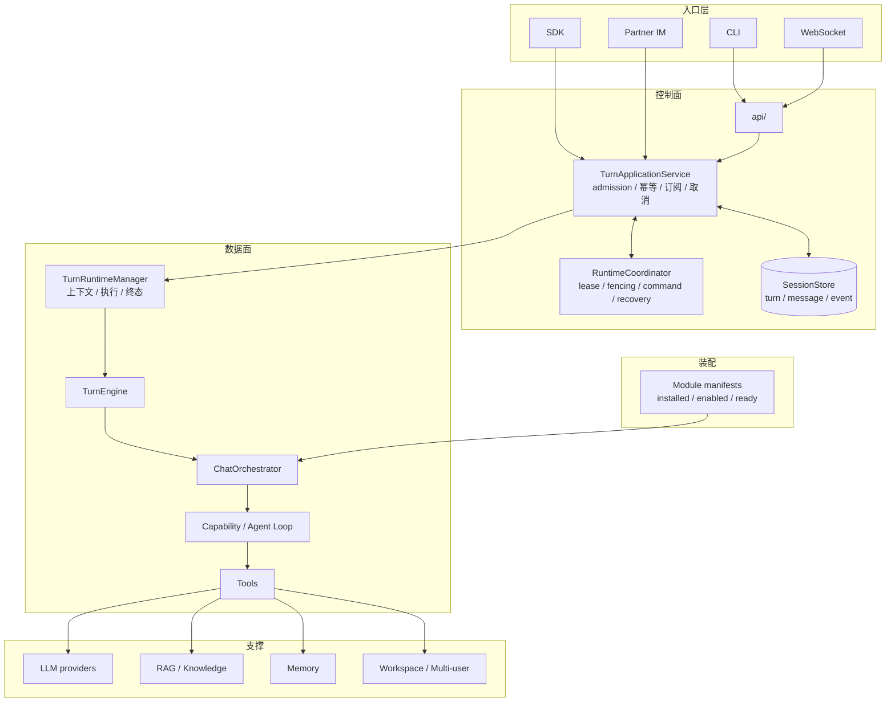
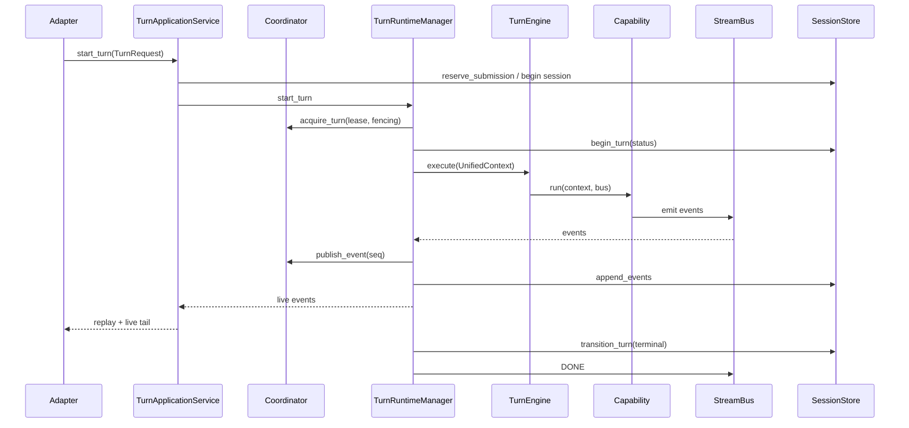
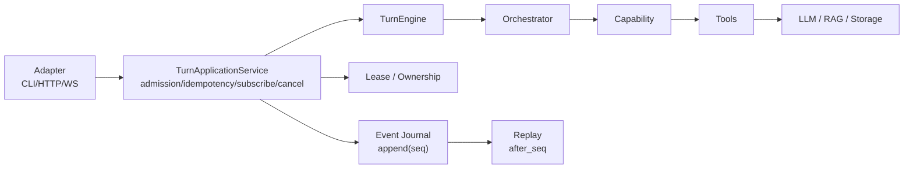

# DeepTutor 架构借鉴报告

> 按 `how-to-read-code` 工作流生成，目的不是复述模块，而是回答：
>
> **DeepTutor 的架构里，哪些设计值得借鉴？为什么？代价是什么？什么情况下不要照搬？**
>
> 结论标签：**[static]** = 基于源码、manifest、测试与文档的静态分析；本次未启动完整应用。
>
> 更细的架构与链路见：
>
> - [`整体架构代码阅读报告.md`](./整体架构代码阅读报告.md)
> - [`工程架构与模块职责.md`](./工程架构与模块职责.md)
> - [`代码链路场景解析.md`](./代码链路场景解析.md)
> - [`项目解析_专业版.md`](./项目解析_专业版.md)

---

## 1. 范围与目的

### 1.1 目的

从“**如果要设计一个类似的 agent-native 平台，应该学什么**”的角度阅读 DeepTutor，回答：

- 哪些架构模式是**跨项目可复用**的？
- 每个模式解决什么问题、付出什么代价？
- 哪些设计只适合 DeepTutor 的规模/产品形态，不适合照搬？
- 如果从零设计，最小可行架构是什么？

### 1.2 环境与运行状态

- 当前 shell 有 `uv`（0.12.3）和 uv 管理的 Python 3.12.13 / 3.14.4；
- 但本次**没有安装完整依赖、没有启动应用**；
- 因此运行时行为、性能数字、真实 backtrace 均为 **[static]**；
- 已完成的替代验证：
  - 解析全部模块 manifest；
  - 阅读入口、应用服务、turn runtime、orchestrator、registry、stream、session、coordination、capability/agent/tool；
  - 阅读测试/CI/文档，确认设计意图与边界。

### 1.3 不在范围

- 单个 provider/RAG/解析器的算法；
- 前端页面细节；
- 桌面打包/签名细节；
- 具体性能调优。

---

## 2. 架构速览（横向）

DeepTutor 架构最核心的五句话：

1. **Turn 是一等公民**，不是一次 HTTP 请求。
2. **控制面与数据面分离**：admission/租约/回放在应用层，执行在 runtime/orchestrator。
3. **事件先持久化，再交付消费者**：流式不是 SSE 的别名，`seq` + journal 才是可回放的基础。
4. **Tool 与 Capability 分层**：模型可选单步操作 vs 拥有整个 turn 的管线。
5. **装配与实现分离**：manifest 决定“装什么、开什么、暴露什么”，代码只在启用后加载。

---

## 3. 核心数据结构：架构的“骨架”

| 结构 | 位置 | 为什么值得学 |
|---|---|---|
| `TurnStatus` / `TurnLease` / `TurnCommand` | `runtime/coordination/types.py` | 把 turn 建模成有状态、有所有权、有命令通道的作业，而不是函数调用 |
| `StreamEvent` | `core/stream.py` | 统一事件协议；`type/source/stage/content/metadata/seq` 是所有消费者共享的语言 |
| `UnifiedContext` | `core/context.py` | 一个 turn 的全部输入与运行时状态；避免在几十个函数间传参 |
| `_TurnExecution` | `services/session/_turn_runtime_shared.py` | 进程内执行记录：task、subscribers、events、lease；把“执行”变成可观察对象 |
| `SessionStoreProtocol` | `services/session/protocol.py` | 存储抽象：SQLite/PocketBase 可替换；turn/event/message 有明确 repository |
| `ToolDefinition` / `BaseTool` | `core/tool_protocol.py` | 工具 schema 与执行契约；模型可见的接口与实现分离 |
| `CapabilityManifest` / `TurnCapability` | `core/capability_protocol.py` | 能力元数据与 `run(context, stream)`；客户端/CLI/校验共用 |
| 模块 manifest | `modules/manifests/*.json` | 发行/运行时/前端/CLI 的单一事实来源；元数据与实现分离 |

### 3.1 为什么这些结构比“类图”更重要

DeepTutor 的很多优点来自**数据结构选得对**：

- 有 `TurnLease`，才谈得上多 worker 所有权与恢复；
- 有 `StreamEvent.seq`，才谈得上断线回放；
- 有 `UnifiedContext`，才谈得上 capability 不依赖具体入口；
- 有 `CapabilityManifest`，才谈得上 CLI/前端/校验共用一份契约；
- 有模块 manifest，才谈得上 core-only / full / feature wheel 的装配。

反过来，如果一开始把这些都做成“函数参数 + 隐式全局状态”，后面很难补。

---

## 4. 纵向分析：用一条 turn 验证这些设计

**这条链路验证了三个关键设计：**

1. **入口不直接执行模型**：所有入口先经过应用服务，保证幂等、回放、取消、恢复一致。
2. **执行不直接写事件**：capability 只发到 `StreamBus`；运行时负责 `seq`、持久化、发布。
3. **终态先落库，DONE 后可见**：客户端不会看到“已完成但事件缺失”的窗口。

---

## 5. 黑盒（有意未展开）

| 接口/模块 | 输入 | 输出 | 为什么不展开 |
|---|---|---|---|
| `services/llm/provider_core/*` | 模型配置、key、wire format | provider client、流式 chunk、usage | 供应商细节多；本报告只关心“如何隔离 provider” |
| `services/rag/pipelines/*` | KB、查询 | 检索结果、引用 | RAG 是独立子系统 |
| `services/parsing/*` | 文档 | 文本/图片/结构 | 解析器与具体库强耦合 |
| `plugins/runtime.py` | 插件 manifest、worker | capability/tool events | 第三方插件协议复杂 |
| `web/features/*` | contracts、transport | React UI | 页面级细节 |
| `packages/chat-engine/*` | seed、scoped ports | TS agent 执行 | 实验性路径 |

---

## 6. 值得借鉴的架构模式（核心）

### 6.1 把 Turn 建模成“持久作业”，而不是“请求”

**问题**：LLM 调用可能持续几十秒到几分钟，期间会流式输出、调用工具、暂停等待用户、被取消、worker 崩溃、客户端断线。

**DeepTutor 做法**：

- `TurnStatus`: `queued / running / waiting_input / completed / failed / cancelled`；
- `TurnLease` + `fencing_token`；
- turn 行 + event journal；
- `TurnRecoveryService` 在 worker 丢失时写 `worker_lost`。

**值得借鉴**：

> 任何长运行、可取消、需要重连的 AI 任务，都应该有“作业”语义：状态、所有权、事件、终态。

**适用条件**：需要断线重连、多 worker、可恢复、可审计。  
**代价**：比“一次 request → 一次 response”复杂得多；小应用可以先从内存队列开始。

**关键文件**：`runtime/coordination/types.py`、`runtime/coordination/recovery.py`、`services/session/turns/lifecycle.py`。

---

### 6.2 控制面与数据面分离

**问题**：如果 CLI、WebSocket、SDK 各自实现“开始/取消/订阅/重试”，逻辑会分叉。

**DeepTutor 做法**：

- 控制面：`TurnApplicationService`（admission、幂等、订阅、取消、回复）；
- 数据面：`TurnEngine` / `ChatOrchestrator` / Capability / Tools。

**值得借鉴**：

> 把“谁可以开始/取消/订阅”和“具体怎么执行”分开；控制面负责一致性，数据面负责能力。

**适用条件**：多入口（CLI/HTTP/WS/SDK/IM）共享同一执行逻辑。  
**代价**：多一层抽象；需要清晰定义 `TurnRequest` 与 `UnifiedContext` 的边界。

**关键文件**：`app/service.py`、`app/contracts.py`、`runtime/turn_engine.py`。

---

### 6.3 Lease + fencing：所有权不能只靠数据库行

**问题**：两个 worker 同时抢同一个 turn；旧 worker 在 lease 过期后仍可能写回。

**DeepTutor 做法**：

- `acquire_turn()` 拿 lease；
- 每次写事件/终态带 `fencing_token`；
- recovery 用 CAS（expected status + fencing token）标记 `worker_lost`；
- lease 续租是活性证据，不用 `updated_at`。

**值得借鉴**：

> 分布式作业需要“租约 + fencing token”，而不是只靠行锁或更新时间。

**适用条件**：多进程/多 worker/容器横向扩展。  
**代价**：需要协调器（内存/Redis）与更复杂的测试。

**关键文件**：`runtime/coordination/protocol.py`、`runtime/coordination/memory.py`、`runtime/coordination/redis.py`、`recovery.py`。

---

### 6.4 持久事件 journal + `seq` + `after_seq` 回放

**问题**：流式输出一旦断开，客户端如何继续？如何避免重复/丢失？

**DeepTutor 做法**：

- capability 只发 `StreamEvent`；
- 运行时分配 `seq`、持久化、发布；
- 客户端带 `after_seq` 重连；
- DONE 后可能还有 `session_meta` 尾巴；
- 终态行无 DONE 时合成 `error` + `done`。

**值得借鉴**：

> 流式系统的核心不是“推得快”，而是“推丢了能补”。事件必须先进入持久化/回放路径，再交付消费者。

**适用条件**：需要断线续传、审计、回放、可恢复。  
**代价**：事件协议与 sequence 语义成为公共契约；存储和测试成本上升。

**关键文件**：`core/stream.py`、`runtime/stream_bus.py`、`services/session/turns/lifecycle.py`、`app/service.py:subscribe_turn`。

---

### 6.5 Tool 与 Capability 两层模型

**问题**：把所有模式塞进一个巨大 chat prompt，会导致提示词、工具面、预算、测试全部纠缠。

**DeepTutor 做法**：

- **Tool**：模型按需选择的单步操作（`web_search`、`rag`、`exec`、`submit_visualization`）；
- **Capability**：拥有整个 turn 的管线（chat、deep_solve、deep_research、mastery_path、video_lesson）；
- Capability 可以复用同一个 agent loop，但有自己的 prompt/预算/工具面。

**值得借鉴**：

> 不要混淆“模型可调用的工具”和“拥有完整流程的能力”。前者是模型的动作，后者是产品的模式。

**适用条件**：有多种 AI 工作流 + 模型工具调用。  
**代价**：需要两套协议、注册表、测试；能力与工具的边界要设计清楚。

**关键文件**：`core/tool_protocol.py`、`core/capability_protocol.py`、`runtime/registry/`、`agents/_shared/tool_composition.py`。

---

### 6.6 统一结果 envelope

**问题**：每个能力都自定义 response/cost/token 格式，前端/CLI/SDK 要写一堆分支。

**DeepTutor 做法**：

- 所有能力最终调用 `emit_capability_result(stream, payload, source, usage)`；
- 合并 `cost_summary` / `usage_summary`；
- Orchestrator 统一发 DONE 和错误终态。

**值得借鉴**：

> 终态契约要统一：response + metadata + usage/cost + status。能力只负责内容，不负责发明信封。

**适用条件**：多能力、多客户端、需要统一计费/统计。  
**代价**：能力必须遵守 envelope；特殊 payload 需要放进 metadata。

**关键文件**：`agents/_shared/capability_result.py`、`runtime/orchestrator.py`。

---

### 6.7 工具组合策略是“纯函数 + 显式 flags”

**问题**：工具可用性散落在各 pipeline 的 if 里，UI 与运行时容易不一致。

**DeepTutor 做法**：

- `USER_TOGGLEABLE_TOOL_NAMES`（用户可开关）；
- `CONFIGURABLE_BUILTIN_TOOL_NAMES` + `ToolMountFlags`（上下文自动挂载）；
- `WORKSPACE_BASELINE_TOOLS`（共享工作区工具不被挤掉）；
- `compose_enabled_tools()` 纯函数决定最终工具面。

**值得借鉴**：

> 工具可用性应该是“输入（用户 toggle + 上下文 flags）→ 输出（工具列表）”的纯函数，而不是散落的条件分支。

**适用条件**：工具多、用户可配置、能力有专用工具。  
**代价**：需要维护 flags 与能力声明的一致性；测试要覆盖 mount rules。

**关键文件**：`agents/_shared/tool_composition.py`、`tools/builtin/__init__.py`、`tools/builtin_specs.py`。

---

### 6.8 manifest 驱动装配 + installed/enabled/ready 三态

**问题**：包装、运行时注册、API 路由、CLI 命令、前端导航分散在多个地方，容易漂移。

**DeepTutor 做法**：

- `modules/manifests/*.json` 一份 JSON 声明路径、依赖、能力、工具、路由、命令、导航、requirements、executables；
- `installed / enabled / ready` 三态；
- 读取 manifest 不 import feature，避免可选依赖缺失导致 core 启动失败。

**值得借鉴**：

> 模块化产品需要“元数据与实现分离”的装配层；安装、启用、就绪必须是不同概念。

**适用条件**：有可选功能、独立发行、插件生态。  
**代价**：manifest 校验、依赖无环、路径归属、生成 requirements 都需要工具链支持；小项目可能过度设计。

**关键文件**：`modules/catalog.py`、`modules/manifests/*.json`、`runtime/bootstrap/builtin_capabilities.py`。

---

### 6.9 import-light core + 强制依赖边界

**问题**：启动时 import 所有 provider/parser/feature，导致启动慢、可选依赖缺失就崩。

**DeepTutor 做法**：

- `core` 只放协议/值对象；
- registry 用 lazy descriptor；
- `.importlinter` 禁止 core 反向依赖，禁止 runtime/services/... import api；
- `scripts/check_architecture.py` 补充检查。

**值得借鉴**：

> 架构边界要写进 CI：谁可以 import 谁，不能只靠 code review 记忆。

**适用条件**：中大型代码库、多模块/多团队。  
**代价**：需要 import-linter/架构测试；lazy loading 增加间接层。

**关键文件**：`.importlinter`、`scripts/check_architecture.py`、`runtime/registry/`、`runtime/bootstrap/`。

---

### 6.10 “智能在 loop 出口，确定性骨架在引擎”

**问题**：让 LLM 同时负责教学策略、状态推进、评分、引用校验，容易不可靠、不可测。

**DeepTutor 做法**：

- chat/solve/mastery/reading 的注释反复强调：模型负责计划/教学/阅读判断；确定性 spine（plan、gate、locate、citation）由引擎/工具执行；
- mastery 的 per-type gate、spaced-repetition 在 `learning/`；
- reading 的 quote grounding 在引擎侧校验；
- solve 的 `solve_plan`/`solve_finish_step`/`solve_replan` 是工具化的确定性 spine。

**值得借鉴**：

> 用 LLM 做判断和生成，用确定性代码做状态推进、校验和不变式。不要把“业务规则”全部交给 prompt。

**适用条件**：教学、工作流、审批、评分等需要可解释/可测试的领域。  
**代价**：需要设计工具化的状态机；prompt 与引擎要协同。

**关键文件**：`capabilities/mastery/pipeline.py`、`capabilities/solve/session.py`、`capabilities/reading/_grounding.py`、`learning/`。

---

### 6.11 官方模块 vs 第三方插件：不同信任边界

**问题**：第一方功能和第三方扩展如果共用同一套安装/运行/权限模型，安全边界会模糊。

**DeepTutor 做法**：

- 官方模块：wheel + manifest + installed/enabled/ready；
- 第三方插件：manifest + 审批 + worker + 权限声明 + 生命周期；
- `deeptutor.extensions` entry point 是 canonical，旧 `deeptutor.plugins` 兼容一个版本。

**值得借鉴**：

> 第一方功能与第三方扩展应该有不同信任/生命周期边界；不要让第三方代码走第一方后门。

**适用条件**：有插件/扩展生态。  
**代价**：两套协议、审批流程、worker 运行时。

**关键文件**：`plugins/runtime.py`、`plugins/manifest.py`、`plugins/lifecycle.py`。

---

### 6.12 契约优先的前端边界

**问题**：前端与后端一起演进时，API/WS/事件字段容易漂移。

**DeepTutor 做法**：

- `web/contracts/` 由后端 schema 生成；
- `npm run contracts:generate` / `contracts:check`；
- `web/proxy.ts` 统一 API/WS 转发与 auth gate；
- `web/.dependency-cruiser.cjs` 禁止循环、page import、shared 向上依赖、渲染层 import domain/store/transport。

**值得借鉴**：

> 前后端分离时，把契约当生成产物，把 import 边界写进 lint；不要靠“记得改前端”。

**适用条件**：独立前端/多客户端。  
**代价**：生成器、契约 diff、前端构建门禁。

**关键文件**：`web/contracts/`、`web/proxy.ts`、`web/.dependency-cruiser.cjs`。

---

### 6.13 测试“不变式”，而不只是函数

**问题**：async/流式/恢复系统的 bug 往往在重连、取消、worker 丢失、重复提交，而不是单函数。

**DeepTutor 做法**：

- `tests/app`、`tests/runtime/coordination`、`tests/api`、`tests/knowledge`；
- 事件 replay、cancel、worker_lost、idempotency、contract generation、architecture boundaries；
- `web` 侧 typecheck/architecture/contracts/i18n/Node/Vitest/Playwright；
- CI 覆盖 Python 3.11–3.14、Redis、Windows、桌面、TS engine、视频沙箱。

**值得借鉴**：

> 对 durable/async 系统，测试要覆盖“失败与恢复语义”，而不只是 happy path。

**适用条件**：任何有状态/流式/多 worker 系统。  
**代价**：测试量大、fixture 复杂；但这是可靠性的必要成本。

**关键文件**：`tests/runtime/coordination/`、`tests/app/`、`.github/workflows/tests.yml`。

---

### 6.14 失败语义先定义：部分结果、取消、worker 丢失

**问题**：失败时如果直接丢掉一切，用户体验和可恢复性都很差。

**DeepTutor 做法**：

- 取消时尽量持久化已产出的答案/附件/trace；
- `worker_lost` 写 `error` + `done`，`retryable=true`；
- 终态行无 DONE 时合成 DONE；
- DONE 后保留 `session_meta` 尾巴。

**值得借鉴**：

> 先定义“失败/取消/丢失时保留什么、客户端看到什么”，再写实现。

**关键文件**：`services/session/turns/executor.py`（CancelledError 分支）、`runtime/coordination/recovery.py`、`app/service.py`。

---

### 6.15 Workspace/账户隔离：路径必须走服务

**问题**：全局 `data/` 路径会让多用户/多 workspace 串数据。

**DeepTutor 做法**：

- `services/path_service.py` / `services/workspace/` 解析当前账户/workspace；
- `multi_user/` 管账户、guardian、grants、per-account secrets；
- tests/conftest 守卫真实 secret tree，防止测试写真实用户数据。

**值得借鉴**：

> 任何资源路径都通过“当前账户/workspace context”解析；不要构造全局数据路径。

**关键文件**：`services/path_service.py`、`services/workspace/`、`multi_user/`、`tests/conftest.py`。

---

### 6.16 桌面壳只做生命周期，不复制业务 API

**问题**：桌面端如果复制业务代码，会形成第二套后端。

**DeepTutor 做法**：

- Electron shell 只管理启动、就绪、关闭、core artifacts；
- Web 内容无 preload/Node integration/desktop IPC 权限；
- 只保留私有 shell 页面的 native bridge。

**值得借鉴**：

> 桌面壳应该是“运行时监督者”，不是业务后端；复用 Web UI 和同一套 API。

**关键文件**：`apps/desktop/README.md`、`apps/desktop/src/`。

---

## 7. 哪些设计不要照搬 / 需要裁剪

| 设计 | 什么时候不要照搬 | 替代方案 |
|---|---|---|
| 完整 durable turn runtime | 单机、短任务、无需重连的小应用 | 先做内存队列 + 简单状态；需要时再加 journal/lease |
| 26 个 manifest 模块 | 小型团队/单产品 | 先用 DI/插件框架；等有独立发行需求再上 manifest |
| 自定义 DSML/label 协议 | 只需要标准 tool calling | 优先用 provider 原生 tool call；DSML 是为兼容性/流式恢复 |
| 双存储（SQLite/PocketBase） | 没有迁移需求 | 先选一个 store；抽象 protocol 但不要同时实现两套 |
| 双引擎（Python/TS） | 没有性能/实验需求 | 只保留一个调度器 |
| 兼容 facade / 旧入口 | 新项目 | 不要预埋兼容层；在真实迁移窗口再引入 |
| 超大文件（4k–5k 行） | 新项目 | 按聚合/状态机拆分；不要以“先堆起来”为默认 |
| 全部 provider/RAG/IM 矩阵 | 产品未验证 | 先做 1 个 provider + 1 个 RAG + 1 个通道 |
| 30 万行测试 | 项目早期 | 先做核心 invariant/契约测试；随功能扩展 |
| 最新版本组合（Next 16/React 19/Python 3.14） | 团队/生态不成熟 | 选 LTS/稳定版本；或明确升级窗口 |

### “如果是我，会怎样不同”

- 用一个显式 `TurnState` 状态机替代 `TurnRuntimeManager` 的 6 个 mixin 和 1,700 行兼容值层；
- 在 turn 开始时生成 `TurnCapabilityPlan`（能力 + 工具 + 资源权限 + 模块状态），执行阶段只消费计划；
- 把 `sqlite_store.py` 按聚合拆分（session/message/turn/event/usage/notebook）；
- 统一 `core/capability_protocol.py` 与 `capabilities/protocol.py` 的命名/权威；
- 减少兼容 facade，明确唯一注册路径。

---

## 8. 如果从零设计：最小可行架构

### Phase 1：先把 turn 做对

1. 定义 `Turn` 实体与状态机：`queued → running → waiting_input → completed/failed/cancelled`。
2. 定义 `StreamEvent`：`type/source/stage/content/metadata/seq`。
3. 定义 `TurnApplicationService`：`start_turn`、`subscribe_turn(after_seq)`、`cancel_turn`、`submit_user_reply`。
4. 定义 event journal：append-only、`seq` 单调、terminal 先落库。
5. 定义 lease：owner、expires、fencing token；先做单机内存版，再换 Redis。

### Phase 2：再把能力/工具分层

1. `Tool`：schema + `execute` + `ToolResult`。
2. `Capability`：`run(context, stream)` + manifest + `emit_capability_result`。
3. 工具组合纯函数：用户 toggle + 上下文 flags + capability 工具。
4. 能力注册表 + lazy loading；不要让 core import 所有 feature。

### Phase 3：再做模块与前端边界

1. 模块 manifest：路径、依赖、能力、工具、路由、命令、导航。
2. `installed/enabled/ready` 三态。
3. 前端契约生成 + proxy + dependency rules。
4. import-linter/架构测试。

### Phase 4：最后做可靠性与生态

1. 多 worker：Redis coordinator、lease/fencing、recovery。
2. 取消/worker_lost/部分结果保留。
3. 插件/第三方扩展：manifest、审批、worker。
4. golden trace/contract tests。

---

## 9. 开放问题与后续阅读

- [ ] **跑一次真实 turn**：`uv venv --python 3.12` → `uv pip install -r requirements/full.txt` → `deeptutor run chat "..." --format json`，观察事件 seq 与 replay。
- [ ] **测量 durable runtime 的代价**：lease 续租、event flush、journal 写入对延迟的影响。
- [ ] **对比 WeKnora4j / 其他 agent 平台**：哪些模式是通用的，哪些是 DeepTutor 特有的。
- [ ] **评估 manifest vs DI**：模块数量到什么规模时 manifest 才值得。
- [ ] **读失败语义测试**：`tests/runtime/coordination/`、`tests/app/`、`tests/api/`。
- [ ] **读前端 transport**：`web/lib/reconnecting-websocket.ts`、`stream.ts`、`turn-reconcile.ts`。
- [ ] **读插件/桌面边界**：`plugins/runtime.py`、`apps/desktop/README.md`。

---

## 10. 关键文件索引

| 主题 | 文件 |
|---|---|
| Turn/状态/租约 | `runtime/coordination/types.py`、`protocol.py`、`recovery.py` |
| 应用服务 | `app/service.py`、`app/contracts.py` |
| Turn runtime | `services/session/turn_runtime.py`、`turns/request_preparer.py`、`turns/executor.py`、`turns/lifecycle.py` |
| 事件/流 | `core/stream.py`、`runtime/stream_bus.py` |
| 上下文 | `core/context.py` |
| 能力/工具协议 | `core/capability_protocol.py`、`core/tool_protocol.py` |
| 能力结果 | `agents/_shared/capability_result.py` |
| 工具组合 | `agents/_shared/tool_composition.py`、`tools/builtin_specs.py` |
| 注册表/装配 | `runtime/registry/`、`modules/catalog.py`、`modules/manifests/*.json` |
| 架构边界 | `.importlinter`、`scripts/check_architecture.py` |
| 前端契约/边界 | `web/contracts/`、`web/proxy.ts`、`web/.dependency-cruiser.cjs` |
| 桌面边界 | `apps/desktop/README.md`、`apps/desktop/src/` |
| 测试/CI | `tests/runtime/coordination/`、`tests/app/`、`.github/workflows/tests.yml` |

---

## 11. 结论

DeepTutor 最值得借鉴的不是“它用了 FastAPI/Next.js”，而是它把 **AI 长任务**当成了一个真正的工程问题：

> **作业化 turn + 控制面/数据面分离 + 租约/fencing + durable event journal + 两层插件模型 + manifest 装配 + 强制 import 边界 + 契约优先前端 + 失败语义测试。**

如果你要设计类似系统，优先抄这 10 个“骨架”；不要抄它的体积、兼容层和 26 模块矩阵。  
先做“单机版 turn + event journal + tool/capability 分层”，等产品验证后再加多 worker、manifest、插件生态。
