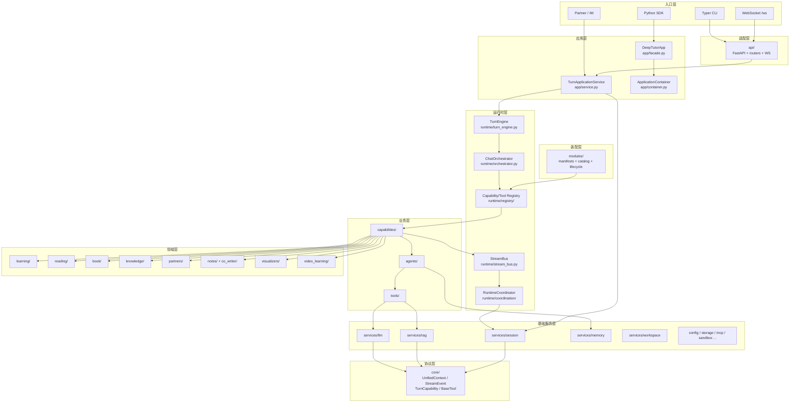
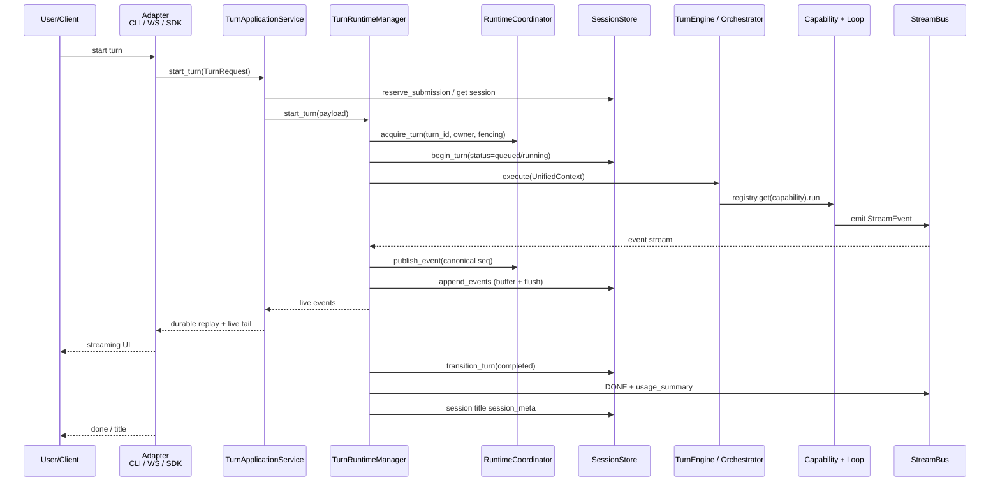

# DeepTutor 项目解析（专业版）

> 本文面向需要做架构评审、二次开发、性能/安全评估或 Java 迁移的读者。  
> 小白向的产品与模块解释见 [`项目解析_小白版.md`](./项目解析_小白版.md)；一次 turn 的完整代码阅读报告见 [`架构阅读报告.md`](./架构阅读报告.md)。

---

## 0. 执行摘要

DeepTutor 是一个 **agent-native 学习工作台**，不是一个单点聊天应用。它的工程形态是：

- **一个 Python 后端运行时**：CLI、WebSocket API、Python SDK 三个入口共用一个 durable turn application service。
- **一个 Next.js 前端**：完整的 workspace/utility/settings/auth/admin 路由体系。
- **一套模块化发行体系**：`deeptutor/modules/manifests/*.json` 是装配权威，支持 core / full / feature wheel。
- **两层插件模型**：Level 1 Tool（模型可选单步操作）+ Level 2 Capability（拥有整个 turn 的管线）。
- **多层基础设施**：LLM provider matrix、多 RAG pipeline、文档解析、Memory、Workspace、MCP、沙箱、IM、桌面端。

核心链路：

```text
CLI / WS / SDK / Partner
  → TurnApplicationService（admission / 幂等 / 取消 / 订阅回放）
  → TurnRuntimeManager（请求准备 / 上下文装配 / 租约 / 执行 / 终态）
  → TurnEngine → ChatOrchestrator（能力路由）
  → Capability / Agent Loop / Tools
  → StreamBus → TurnEventJournal → SessionStore → 适配器回放
```

---

## 1. 代码规模与工程形态

按当前 `git` 跟踪文件统计（包含注释、docstring、类型标注，不是纯 SLOC）：

| 范围 | 行数 | 文件数 |
|---|---:|---:|
| Python 核心 + CLI（含包内测试） | **334,560** | 1,182 |
| Python 独立测试（`tests/` + 包内 learning tests） | **242,927** | 1,014 |
| Web TS/TSX | **335,799** | 1,523 |
| 其中：Web 测试 | ~61,300 | — |
| 其中：生成 contracts | ~46,800 | — |
| TypeScript chat engine | **5,185** | 29 |
| 桌面 shell JS/MJS | **2,268** | 34 |

粗略量级：**总代码约 90 万行；去掉测试与生成代码，生产代码约 60 万行。**

这个规模不是“单点写得啰嗦”，而是产品宽度 × 模块数量 × 供应商/检索引擎数量 × 前端页面 × 可靠性要求 × 测试覆盖共同造成的。第 15 节会区分“合理的大”和“可瘦身的大”。

---

## 2. 分层与依赖边界



### 强制依赖规则

`.importlinter` + `scripts/check_architecture.py` 强制：

```text
core  → 不能 import app / api / runtime / services
runtime / services / knowledge / learning / multi_user / capabilities / agents
      → 不能 import api
app   → 不能 import api
api   → 最外层适配器，可以 import app/runtime/services
```

设计意图：

- `core` 只放稳定协议和值对象，保持 import-light；
- 业务层不反向依赖 API 适配器，避免 FastAPI 污染领域代码；
- `modules/` 只读 manifest，不 import feature 实现，保证 core 安装不会因可选依赖缺失而启动失败；
- `runtime/registry/` 用 lazy descriptor，避免启动时加载无关 provider/parser/feature。

---

## 3. 模块划分与职责

### 3.1 后端分层模块

| 模块 | 关键位置 | 职责 | 扩展点/风险 |
|---|---|---|---|
| **协议层** | `deeptutor/core/` | `UnifiedContext`、`StreamEvent`、`TurnCapability`、`BaseTool`、`ToolDefinition`、错误/身份/trace | 稳定协议，改动影响所有能力 |
| **应用层** | `deeptutor/app/` | `TurnApplicationService`、`DeepTutorApp`、`ApplicationContainer`、`TurnRequest` | admission/幂等/回放/取消的核心 |
| **运行时层** | `deeptutor/runtime/` | `TurnEngine`、`ChatOrchestrator`、`StreamBus`、`RuntimeCoordinator`、registry、bootstrap、agentic 原语、launcher、isolated worker | 最复杂、最需要测试的层 |
| **接入层** | `deeptutor/api/` | FastAPI `main.py`、50 个 router、`unified_ws.py`、`router_loader.py`、`security_guard.py` | 路由按 manifest 加载；WS 命令协议是前端契约 |
| **业务层** | `deeptutor/agents/`、`capabilities/`、`tools/` | agent loop、能力管线、模型可选工具 | 新能力/新工具的落点 |
| **领域层** | `learning/`、`reading/`、`book/`、`knowledge/`、`partners/`、`notes/`、`co_writer/`、`visualizers/`、`video_learning/` | 各学习子系统的领域逻辑与存储 | 每个领域都有独立存储/API/测试 |
| **基础服务层** | `deeptutor/services/` | LLM、RAG、会话、记忆、工作区、存储、MCP、沙箱、解析、Prompt、i18n | 平台能力的主要体量 |
| **装配层** | `deeptutor/modules/` | manifest catalog、模块生命周期、installed/enabled/ready | 发行与运行时装配的单一事实来源 |
| **横切层** | `events/`、`i18n/`、`logging/`、`utils/`、`config/` | 事件总线、国际化元数据、日志、通用工具、设置 | 低耦合基础设施 |

### 3.2 `services/` 子系统

| 组 | 子目录 | 职责 |
|---|---|---|
| **模型** | `llm/`、`model_selection/`、`provider_registry.py`、`embedding/` | provider factory、wire format、OAuth、token/usage、retry、cache、telemetry、traffic control、multimodal |
| **检索** | `rag/`、`search/`、`web_source/`、`research/` | RAG pipeline、embedding binding、index versioning、query rewrite、source visuals、search provider |
| **解析** | `parsing/`、`office_preview.py` | 文档解析抽象、引擎注册、隔离 worker、Office 预览 |
| **会话/运行时** | `session/`、`workspace/`、`path_service.py` | session store、turn runtime、事件 journal、model history、workspace 作用域、迁移 |
| **记忆** | `memory/` | L1 trace、L2/L3 markdown、召回、consolidator |
| **配置/设置** | `config/`、`settings/`、`i18n.py`、`prompt/` | 运行时 settings、PromptManager、语言 |
| **安全/多用户** | `auth.py`、`subagent/`、`keypool.py`、`codex_auth/`、`codebuddy_auth.py`、`github_copilot_auth.py` | 认证、凭据、OAuth、agent connector |
| **协作/扩展** | `partners/`、`partner_groups/`、`mcp/`、`cli_apps/`、`sandbox/`、`skill/` | Partner、MCP、CLI app、沙箱、Skill |
| **内容/学习** | `notebook/`、`practice/`、`calendar/`、`learning_journal/`、`persona/`、`creations/`、`task_board.py` | Notebook、题库、日历、学习日志、Persona、创作物 |
| **媒体** | `voice/`、`imagegen/`、`videogen/`、`generation_http.py` | TTS/STT、图片/视频生成、生成 HTTP |
| **运维** | `app_update.py`、`doctor.py`、`storage/`、`file_io.py`、`base_sync.py`、`github_source/`、`suggestions.py`、`singleflight_cache.py` | 更新、诊断、文件、同步、建议、单飞缓存 |

### 3.3 领域模块

| 模块 | 职责 | 关键点 |
|---|---|---|
| `learning/` | 掌握式学习：mastery、grading、assessment、question card、review strategy、scheduler、topic generation/materials、visual practice、storage、prompts | 学习状态机 + 评分/复习策略 |
| `reading/` | 沉浸阅读：ingestion、catalog/store、extract、EPUB bilingual、page render、caption、read aloud、quiz、search、translation、vocabulary、annotations | 文档/媒体阅读与引用 |
| `book/` | Book 引擎/编译器、agents、blocks、prompts、streaming、export、progress、learning overlay、KB health | 长文档生成与流式编译 |
| `knowledge/` | KB 管理、索引运行、进度追踪、manifest、staging、命名、文档添加 | 索引生命周期与发布状态 |
| `partners/` | Partner/IM 运行时：bus、channels、config、network、transcription | 多通道消息与伙伴记忆 |
| `notes/` | 笔记块、proposals、Anki 导出、resources、review、threads | 笔记与复习 |
| `co_writer/` | docx 转换、edit agent、prompts、storage | 协作写作 |
| `visualizers/` | 可视化协议/注册/存储/工具/loop capability、builtin | 可插拔可视化 |
| `video_learning/` | Invidious 账号、marks、notes、reading migration、service | 视频学习与迁移 |
| `multi_user/` | 账户/工作区/角色/资源授权/guardian/learner profile/session handoff | 多用户隔离 |
| `textbook_struct/` | 章节重建、栏黑名单、页眉处理 | 教材结构解析 |

### 3.4 26 个发行模块

`deeptutor/modules/manifests/*.json` 是发行与装配的权威目录，声明 `paths`、`requires`、`optional`、`capabilities`、`loops`、`tools`、`routes`、`commands`、`navigation`、`requirements`、`executables`。

| 模块 | 负责内容 |
|---|---|
| `core` | 持久 turn、chat、ask_questions、共享工具、CLI/SDK、设置、会话 |
| `server` | FastAPI API、认证/路由适配 |
| `web` | 打包的 Next.js Web 资产 |
| `solve` | `deep_solve` + solve planning 工具 |
| `questions` | `deep_question` + `question_bank` |
| `research` | `deep_research` + paper/research 工具 |
| `visualize` | `visualize` + `submit_visualization` |
| `renderer-manim` | `math_animator` + Manim 管线 |
| `video-lesson` | `video_lesson` |
| `audio-overview` | `audio_overview` |
| `knowledge` | KB/RAG、Obsidian/MarginNote/IMA |
| `parsing` | 文档解析基础 |
| `parser-markitdown` / `parser-docling` / `parser-pymupdf4llm` / `parser-liteparse` | 各解析引擎 |
| `reading` | `immersive_reading` + 阅读工具/路由/导航 |
| `mastery` | `mastery_path` + mastery 工具 |
| `books` | Book 引擎/页面/导出/进度 |
| `memory` | `read_memory` / `write_memory` |
| `notebook` | notebook 工具/路由 |
| `co-writer` | notes loop + note 工具 |
| `calendar` | cron 工具 + 日历路由 |
| `partners` | Partner loop/工具/路由/IM 通道 |
| `providers` | 可选模型供应商 SDK |

三态语义：

```text
installed = 当前 Python 环境是否安装了对应 distribution
enabled   = <home>/data/system/modules.json 是否选择启用
ready     = 依赖包、版本、系统可执行文件、必需模块是否都满足
```

`require_module()` 在执行前硬性检查；`contribution_enabled()` 在注册/发现阶段检查。模块元数据必须能在不 import 可选 feature 的情况下读取。

---

## 4. 一次 turn 的生命周期



### 4.1 Admission

`TurnApplicationService.start_turn()`（`app/service.py:113`）：

1. 验证 `TurnRequest`；
2. 若无 workspace context，按 request 的 `workspace_id` 包一层；
3. 解析 store + `TurnRuntimeManager`；
4. 幂等提交：带 `client_submission_id` 时调用 `store.reserve_submission()`；同一 submission 已有非失败 turn 则直接返回；
5. 调用 `runtime.start_turn(payload)`；
6. 处理 `ActiveTurnConflict`：reclaim 无 lease 的僵尸 turn 后重试一次；
7. 更新 session preferences（语言、引用、KB、workspace dependencies）。

这一层只负责“这次提交是否被接受、是否重复、是否与现有 turn 冲突”，不执行模型。

### 4.2 请求准备与租约

`TurnRequestPreparer`（`services/session/turns/request_preparer.py:795` 附近）：

1. 解析 session/capability/workspace/persona/LLM/KB/附件/memory/mastery/reading；
2. 有 coordinator 时生成 `turn_id` 并 `acquire_turn(turn_id, "{scope}:{session_id}", owner_id)`；
3. 租约成功后才 `store.begin_turn(...)`，写入 turn 行与 `owner_id`/`fencing_token`；
4. 在 `_executions` 注册 ownership marker，防止并发 `start_turn` 误判；
5. mastery 路径可能额外获取 mastery path lease；
6. 发布进入事件并启动执行任务。

**顺序是 invariant：先拿 lease，再插 turn 行。** 这样新 turn 在首次续租前就受保护；恢复逻辑看到“有行无 lease”才能判定 worker 丢失。

### 4.3 上下文装配

`TurnExecutor`（`services/session/turns/executor.py:69`）把请求变成 `UnifiedContext`：

- 历史消息（含分支选择）；
- memory、learning journal、persona、skills、source manifest；
- 附件、引用、question bank、book/reading/mastery 上下文；
- LLM 配置与 provider 状态；
- 不可序列化状态放进 `context.runtime`。

然后调用 `self.turn_engine.execute(context)`。

### 4.4 引擎与能力路由

`TurnEngine.execute()`（`runtime/turn_engine.py:17`）非常薄：

```text
interactive_memory_scope()
  → ChatOrchestrator()
  → orchestrator.handle(context)
```

`ChatOrchestrator.handle()`（`runtime/orchestrator.py:64`）：

1. 有 KB 时 `require_module("knowledge")`，校验 PageIndex 选择；
2. `answer_by` 有值时选择 `HandoffCapability`；
3. 否则 `cap_name = active_capability or "chat"`，从 `CapabilityRegistry.get()` 取能力；
4. 发 `SESSION` 事件；
5. 创建 `StreamBus`，按 `turn_id` 注册；
6. 独立 task 执行 `capability.run(context, bus)`；
7. 正常返回但 `bus.result_completion is False` → `capability_incomplete`；
8. 异常 → `error` 事件，保留 `error_code`/`retryable`/`partial_response`；
9. `finally` → `DONE`，带 `status`、错误元数据、`usage_summary`；
10. 消费端提前停止时取消执行 task；
11. 最后向全局 `EventBus` 发布 `CAPABILITY_COMPLETE`。

### 4.5 事件持久化与回放

当一个 capability 向 `StreamBus` 发事件，`_publish_live_event()`（`services/session/turns/lifecycle.py:681`）负责：

1. DONE 补 `usage_summary`；
2. 补 `session_id`/`turn_id`；
3. 协调器 `publish_event()` 分配/返回规范 `seq`；
4. `_lock` 内追加到 `execution.events`，维护 `next_seq`；
5. DONE 或积压 ≥25 条立即 flush；否则 0.25s 延迟 flush；
6. 推给进程内 live subscriber。

`TurnApplicationService.subscribe_turn()`（`app/service.py:248`）：

1. 先从 `store.get_events(turn_id, after_seq)` 做 durable replay；
2. 再从 `coordinator.read_events(turn_id, after_seq)` 读其他 worker 的 live tail；
3. 看到 DONE 且无 post-turn 尾巴 → 结束；
4. DONE 后仍可能有标题 `session_meta` → 等 lease 消失或超时；
5. turn 行已终态但 durable 事件无 DONE → 合成 `error` + `done`。

### 4.6 终态、取消与恢复

- **正常完成**：flush 非终态事件 → `transition_turn(completed)` → 发布 DONE → flush → 生成标题 → 最终 flush。
- **取消**：`cancel_turn()` 通过协调器发 `cancel`；执行侧尽量持久化已产出的答案/附件/trace，标记 `cancelled`；文件保留。
- **worker 丢失**：`TurnRecoveryService`（`runtime/coordination/recovery.py:15`）由 leader 周期运行：
  - 找到过期 lease；
  - lease 仍活 → 跳过；
  - 先 append 过期 worker 的剩余事件；
  - 以 `fencing_token` 做 CAS，标记 `failed / worker_lost / retryable=true`；
  - 写入 `error` + `done` 并发布。
- **僵尸 turn**：新提交被 `ActiveTurnConflict` 阻塞时，同步 reclaim “无 lease 的活跃行”。

**核心 invariants：**

1. 事件必须先进入持久化/回放路径，再交付消费者；
2. terminal 行先落库，DONE 后可见；
3. lease 是唯一活性证据，turn 行 `updated_at`/事件安静都不能判定 worker 死亡；
4. `seq` 属于公共契约，不能每个进程从 1 重新开始；
5. 取消/worker 丢失必须保留已产出的部分结果。

---

## 5. 核心数据结构

| 结构 | 位置 | 谁创建/持有/修改 | 作用 |
|---|---|---|---|
| `UnifiedContext` | `core/context.py:92` | 上下文装配器创建；`TurnEngine`/`Orchestrator`/Capability 持有；Capability/loop 修改 | 一个 turn 的全部输入与运行时状态 |
| `TurnRuntimeContext` | `core/context.py:50` | 上下文装配器创建 | 不可序列化回调、模型历史、workspace 快照、`ask_user` 通道 |
| `WorkspaceRuntimeContext` | `core/context.py:34` | workspace 解析创建 | 冻结本次 turn 的 workspace 根/输出目录/安全级别 |
| `Attachment` | `core/context.py:16` | 请求解析创建 | 图片/文件/PDF 附件 |
| `InteractionState` | `core/context.py:74` | 上下文装配器创建 | `end_loop`、用户答案 |
| `CapabilityOutput` | `core/context.py:82` | Capability 写入 | 统一终态输出与事件元数据 |
| `StreamEvent` | `core/stream.py:37` | Capability/Tool/Orchestrator 创建；运行时补 `seq`/`turn_id` | 15 种事件：stage/thinking/content/tool/result/error/done 等 |
| `TurnRequest` | `app/contracts.py` | 适配器创建；应用服务验证 | 跨入口统一请求契约 |
| `TurnLease` | `runtime/coordination/types.py:44` | Coordinator 创建；Executor 持有/续租 | turn 所有权与 fencing |
| `TurnCommand` | `coordination/types.py:60` | 适配器/应用服务创建 | cancel/submit_user_reply/user_input |
| `_TurnExecution` | `services/session/_turn_runtime_shared.py:1422` | RequestPreparer 创建；RuntimeManager 持有 | 进程内执行记录：task/subscribers/events/lease |
| `SessionStoreProtocol` | `services/session/protocol.py:149` | `get_session_store()` 创建 | session/message/turn/event 统一协议 |
| `ToolDefinition` / `BaseTool` | `core/tool_protocol.py:77` | 工具实现 | 工具 schema 与执行契约 |
| `CapabilityManifest` / `TurnCapability` | `core/capability_protocol.py:33` / `:46` | 能力实现 | 能力元数据与 `run(context, stream)` |
| 模块 manifest | `modules/manifests/*.json` | 模块作者 | 贡献归属/依赖/路由/命令/导航 |
| Memory L1/L2/L3 | `services/memory/` | `MemoryStore` / consolidator | 原始轨迹 → 事实 → 综合记忆 |

---

## 6. Tool / Capability 两层模型

### Level 1 — Tool

定义：`BaseTool` / `ToolDefinition` / `ToolResult`（`core/tool_protocol.py`）。一个工具是“模型选择的一次操作”。

三类内置工具：

1. **用户可开关的 8 个工具**（`USER_TOGGLEABLE_TOOL_NAMES`）：
   `brainstorm`、`web_search`、`paper_search`、`zotero_search`、`reason`、`geogebra_analysis`、`imagegen`、`videogen`。
2. **上下文自动挂载**（`CONFIGURABLE_BUILTIN_TOOL_NAMES` + `ToolMountFlags`）：
   `rag`、`kb_files`、`read_source`、`read_memory`、`read_skill`、`load_tools`、`exec`、`ask_user`、`list_notebook`、`save_favorite`、`question_bank`、mastery 导航等。
3. **能力私有工具**：
   `solve_plan` / `solve_finish_step` / `solve_replan`、`submit_visualization`、mastery/reading/partner 系列等。

工具发现还支持：

- deferred tools：`ToolRegistry.deferred_tools()` + `load_tools`；
- 别名：`TOOL_ALIASES` / `_resolve_request`；
- 作用域：`ScopedToolRegistry`、`ToolScope`；
- 插件/MCP/CLI deferred loader。

**可用性 ≠ 权限**：账户授权、workspace 资源策略、模块状态、能力激活、Partner allow/deny 必须在发现和派发两个环节保持有效。

### Level 2 — Capability

定义：`TurnCapability` / `CapabilityManifest`（`core/capability_protocol.py`）。一个能力拥有整个 turn，消费 `UnifiedContext` 并向 `StreamBus` 发事件。

| Capability | 模块 | 阶段/形态 |
|---|---|---|
| `chat` | core | exploring → responding（单 agent loop） |
| `ask_questions` | core | responding（chat loop 强制 `ask_user`） |
| `deep_solve` | solve | responding（chat loop + solve planning tools） |
| `deep_question` | questions | ideation → generation |
| `deep_research` | research | rephrasing → decomposing → researching → reporting |
| `visualize` | visualize | analyzing → generating → reviewing；可路由 Manim 子阶段 |
| `math_animator` | renderer-manim | concept_analysis → concept_design → code_generation → code_retry → summary → render_output |
| `mastery_path` | mastery | responding（Guided Learning loop + mastery tools） |
| `immersive_reading` | reading | responding（文档/时间戳 grounded 阅读循环） |
| `video_lesson` | video-lesson | code_generation → render_check → render_output |
| `audio_overview` | audio-overview | retrieving → script_writing → voice_generation → publishing |

所有能力结束时应调用：

```text
emit_capability_result(stream, payload, source=..., usage=...)
```

（`agents/_shared/capability_result.py:21`）合并 `cost_summary`/`usage_summary`，再发 `RESULT`。Orchestrator 负责 DONE 与异常终态；能力不应发明另一套 completion envelope。

### 挂载规则

`agents/_shared/tool_composition.py` 是单一策略：

- `AUTO_MOUNTED_TOOLS`：pipeline 根据上下文自动挂载，不出现在用户设置；
- `CONDITIONAL_MOUNT_FLAGS`：`has_kb` → `rag`/`kb_files`，`has_memory` → `read_memory`，`has_exec` → `exec` 等；
- `WORKSPACE_BASELINE_TOOLS`：workspace 工具不被能力专用工具面挤掉；
- 用户 toggle 来自 `USER_TOGGLEABLE_TOOL_NAMES`。

原则：

> 切换模式不能悄悄拿掉用户已经打开的工具。专用 loop 继承 chat 工具面，再叠加自己的工具；只有显式 override 才收窄。

---

## 7. LLM / Provider 层

`services/llm/` 的主要职责：

| 能力 | 位置/说明 |
|---|---|
| provider factory | `provider_factory.py`，按 provider/backend/wire format 构建 runtime provider |
| provider core | `provider_core/`，统一 `LLMProvider` 接口与后端适配 |
| wire format | `auto` / `openai_chat` / `openai_responses` / `anthropic` 等 |
| OAuth/凭据 | OpenAI Codex、GitHub Copilot、CodeBuddy 等 |
| 模型目录 | `services/model_selection/`、`provider_registry.py`、`config` |
| token/usage | `tiktoken`/`jtokkit`、`UsageTracker`、`usage_ledger.py` |
| 可靠性 | retry、request cache、traffic control、error mapping、telemetry |
| 多模态 | `image_caption_batch.py`、`image_caption_cache.py`、`image_description.py`、`image_replay.py`、`multimodal.py` |
| 本地/云 | `local_provider.py`、`cloud_provider.py`、`minimax_models.py` |

`runtime/agentic/` 则是 agent loop 的底层原语：

- `client.py`：OpenAI/Azure client + completion kwargs；
- `labels.py` / `labeled_step.py`：label 协议解析；
- `tool_dispatch.py`：并行工具执行、per-tool sub-trace；
- `loop.py`：迭代调度；
- `usage.py`：token 累计；
- `think_stream.py` / `tool_call_stream.py` / `tool_arg_guard.py`：流式与参数保护。

**风险点**：provider-specific quirks、OAuth 凭据生命周期、不同 wire format 的 tool-call 语义、SDK 与自建 HTTP/SSE 的 parity、usage 记账口径。

---

## 8. RAG / Knowledge 层

| 组件 | 职责 |
|---|---|
| `services/rag/service.py` | 统一 RAG 入口，按 KB 绑定 provider |
| `services/rag/factory.py` | pipeline factory（LlamaIndex/PageIndex/GraphRAG/LightRAG 等） |
| `services/rag/pipelines/` | 各检索/索引 pipeline |
| `services/rag/embedding_binding.py` | KB embedding 绑定 |
| `services/rag/index_versioning.py` | 索引版本/发布状态 |
| `services/rag/query_rewrite.py` | 查询改写 |
| `services/rag/smart_retriever.py` | 检索策略 |
| `services/rag/source_visuals.py` | 源文档视觉/图片证据 |
| `knowledge/indexing_run.py` | 索引任务 journal |
| `knowledge/progress_tracker.py` | 索引进度快照/事件 |
| `knowledge/manifest.py` | KB manifest 渲染 |
| `services/parsing/` | 解析抽象、引擎注册、隔离 worker |
| `parser-*` 模块 | MarkItDown/Docling/PyMuPDF4LLM/LiteParse |

设计要点：

- **indexing journal 先于 UI 进度**：进度只是观测，不是“已发布”的证明；
- **重建不能替换可查询的旧版本为 partial candidate**；
- **解析/检索任务有 task identity**，重连时按 workspace scope + task id 对齐；
- **RAG 结果必须保留 citation locator**，否则前端无法做 source-linked 引用。

**风险点**：不同 pipeline 的 chunk/retrieval 语义不一致；embedding 模型变更需要重建索引；多解析器输出格式差异；PageIndex/LightRAG 与 Java/其他实现的对等性。

---

## 9. 学习领域模块

| 模块 | 核心职责 | 关键设计 |
|---|---|---|
| `learning/` | mastery path、grading、assessment、question card、review strategy、scheduler、topic generation/materials、visual practice | 学习状态机、按 topic type 门控工具、评分与复习策略 |
| `reading/` | 文档/EPUB/PDF/视频阅读、目录、页面渲染、朗读、翻译、词汇、引用、quiz | 阅读上下文冻结、selection grounding、citation locator |
| `book/` | 书籍编译器、章节、页面、流式生成、导出、进度、learning overlay | 长文档流式编译与页面级持久化 |
| `questions/` | `deep_question`、题库、练习、AI 评判 | ideation → generation；题库与 follow-up |
| `calendar/` | 日历、cron、提醒 | 定时任务与单实例假设 |
| `notebook/` | 笔记、收藏、题库条目 | 笔记块与引用 |
| `co-writer/` | 协作写作、DOCX 转换、edit agent | 文档编辑 agent |
| `notes/` | 笔记块、proposals、Anki 导出、review | 复习与导出 |
| `memory/` | L1/L2/L3、召回、consolidator | 记忆可见、可编辑、可审计 |
| `partners/` | IM 伙伴、通道、群组、persona、记忆 | 通道适配 + 伙伴独立记忆 |
| `multi_user/` | 账户、工作区、角色、资源授权、guardian | 授权与 workspace 隔离 |
| `visualizers/` | 可视化协议/注册/工具/loop | SVG/Chart.js/Mermaid/HTML；Manim 子阶段 |
| `video_learning/` | 视频标记、笔记、账号、迁移 | 视频学习状态与迁移 |

---

## 10. 前端架构

- **App Router**：`web/app/`
  - `(workspace)`：home、chat、learning（books/mastery/reading/watching）、co-writer、partners、calendar、kanban、whisper；
  - `(utility)`：space、memory、knowledge-bases、notebooks、agents、personalization、profile、settings；
  - `(settings)`、`(auth)`、`(admin)`；
  - `handoff/page.tsx`。
- **Feature 切片**：`web/features/` — chat、settings、notes、calendar、knowledge、co-writer、multi-user、capabilities、runtime-status、tasks、ui-layout。
- **共享原语**：`web/shared/` — api/auth/storage/ui。
- **生成契约**：`web/contracts/` — 由 `npm run contracts:generate` 生成，不要手改。
- **代理**：`web/proxy.ts` — `/api/*`、`/ws/*` rewrite 到后端；多用户模式登录门禁。
- **依赖规则**：`web/.dependency-cruiser.cjs` 禁止循环、`contracts/` 反向依赖、`shared/` 向上依赖 `app|components|context|features`、`features/*/(model|store|transport)` 依赖渲染层、`lib/` 依赖 UI、任何模块 import `page.tsx`。
- **传输**：`web/lib/reconnecting-websocket.ts`、`stream.ts`、`session-events.ts`、`turn-reconcile.ts` 负责连接、`after_seq` 续传、DONE 后 `session_meta` 尾巴、持久化消息与流式 trace 的 reconcile。

**前端不变的契约含义**：后端必须保持 HTTP/WS/事件/错误码/路由/导航/字段形状；任何字段漂移都会直接坏页面。

---

## 11. 配置、存储、多用户与安全

- `DEEPTUTOR_HOME` 指向“拥有 `data/` 的目录”，不是 `data/` 本身。
- `runtime/home.py` 解析 home；`services/config/runtime_settings.py` 管理 `data/user/settings/*.json`。
- 项目根 `.env` 不会自动加载；容器有自己的 JSON→环境变量入口。
- `services/session/sqlite_store.py` 默认存储；`pocketbase_store.py` 可选；`SessionStoreProtocol` 统一 session/message/turn/event。
- `services/workspace/` + `services/path_service.py` 解析当前账户/workspace 路径；不要构造全局 data 路径。
- `multi_user/` 管理账户、guardian、grants、book/knowledge/learning/model/partner/skill/tool access、per-account secrets、session handoff。
- `services/mcp/secrets.py` 分离 MCP 凭据与用户配置；`services/cli_apps/` 管理 CLI app 安装/运行；`runtime/isolated_worker.py` 是短生命周期解析 worker（不是不可信代码 OS 沙箱）。
- `services/sandbox/` 处理代码/视频执行、取消、超时、进程树清理。
- 浏览器响应不得返回凭据或私有 provider replay metadata。

---

## 12. 模块化发行与插件

### 发行

- 源码检出：`module enable/disable` 改写 `<home>/data/system/modules.json`；所有源码在树上。
- wheel 环境：`module install/uninstall` 真正安装/移除 distribution。
- `python scripts/sync_module_requirements.py --check` 检查生成 requirements 漂移。
- `python scripts/build_modules.py --output dist/modules` 构建本地 wheel 族。
- `deeptutor[full]` 是安装 profile，不是永久 metapackage；任何 feature 都能单独卸载。
- feature wheels 必须与 core 同版本；`deeptutor-cli` 是兼容元包。

### 插件

`deeptutor/plugins/` 提供：

- manifest、catalog、distribution、environment、frontend、lifecycle、loader、registry、runtime、transactions；
- 第三方插件的审批、worker、HTTP/static page；
- `deeptutor.extensions` 是 canonical entry point group；旧 `deeptutor.plugins` 兼容一个版本。

插件不是官方模块 wheel；两者边界不同：模块是官方发行，插件是第三方扩展 + 审批/生命周期。

---

## 13. 测试、CI 与部署

### Python

```bash
python -m pytest -q tests/path/to/test_file.py
python -m pytest -q tests/path/to/test_file.py::test_name
python -m pytest -q tests/app tests/runtime/coordination
python -m pytest -q tests deeptutor/learning/tests

python -m ruff check .
python -m ruff format --check .
lint-imports
python scripts/check_architecture.py
python scripts/sync_module_requirements.py --check
python scripts/check_repo_hygiene.py
python scripts/check_workspace_hygiene.py   # 需要干净工作树
pre-commit run --all-files
```

### Web

```bash
cd web
npm run typecheck
npm run architecture:check
npm run test:node
npm run test:unit
npm run lint
npm run i18n:check
npm run contracts:check
npm run check:fast
npm run check          # + production build + route budgets
npm run contracts:generate
npm run audit           # Playwright，需要运行中的前端
```

### CI

`.github/workflows/tests.yml` 覆盖：

- Python 3.11/3.12/3.13/3.14 矩阵；
- Redis service（`DEEPTUTOR_TEST_REDIS_URL`）；
- 可选 LightRAG/GraphRAG；
- 关键模块 import、懒加载、isolated worker 协议；
- Windows 进程所有权与 hidden launch；
- Web `npm run check` + Playwright audit；
- 桌面 shell（Ubuntu/Windows）；
- 实验性 TypeScript chat engine；
- 视频课沙箱（Ubuntu/macOS/Windows）；
- 多 worker 浏览器验收（需 `DEEPTUTOR_MULTI_WORKER_E2E_URL`）。

### 部署

- **源码/CLI**：`deeptutor start --dev`、`deeptutor serve`、`deeptutor run`。
- **PyPI 模块**：`deeptutor[full]` 或核心 `deeptutor`；feature wheels 同版本。
- **Docker**：`compose.yml` / `compose.yaml` / Dockerfile；单端口 3782 或分离端口。
- **桌面**：`apps/desktop` 的 Electron shell + bundled Python/Node/Next；发布要求 Intel Mac、Apple Silicon、Windows installer、portable ZIP 全部齐全，并等待 `verify-release`。

---

## 14. 设计取舍与技术债

### 合理的设计取舍

1. **Durable application service first**
   - 三个入口共享 admission/幂等/回放/取消/恢复；
   - 浏览器断开 ≠ turn 失败；lease 是唯一活性证据；
   - 代价是链路更长。

2. **Tool / Capability 两层**
   - Tool 适合模型自选单步操作；
   - Capability 适合阶段化、专用 prompt/预算/工具面的完整 turn；
   - 避免把所有模式塞进一个巨大 chat prompt。

3. **manifest 驱动模块**
   - 同一 JSON 服务源码归属、wheel 打包、运行时注册、API 路由、CLI 命令、前端导航；
   - 读取 manifest 不 import feature，保证 core 安装不会因可选依赖缺失而启动失败；
   - 代价是 manifest 必须无环、无重复归属、路径合法。

4. **StreamBus + durable seq**
   - 进程内 fan-out 负责低延迟；持久化 journal 负责重连/重启/多 worker；
   - `seq` 由协调器统一分配；
   - 代价是事件协议和 sequence 语义成为公共契约。

5. **import-linter + 架构测试**
   - core 不能反向依赖 app/api/runtime/services；
   - runtime/services/... 不能 import api；
   - app 不能 import api。

### 技术债/可瘦身点

- **兼容 facade**：`CapabilityRegistry` vs `CapabilityCatalog`、`core/capability_protocol.py` vs `capabilities/protocol.py`、旧 `deeptutor.plugins` 入口、legacy chat migration、v1 memory migration。
- **超大文件**：`sqlite_store.py` 约 4,852 行；`turns/executor.py` 约 1,554；`turns/lifecycle.py` 约 821；`turns/request_preparer.py` 约 1,266；`_turn_runtime_shared.py` 约 1,763；`agents/loop/pipeline.py` 约 2,057；`agent_loop.py` 约 1,478。
- **双实现路径**：SQLite/PocketBase、Python scheduler/TypeScript engine，带来大量条件分支与兼容代码。
- **生成 contracts 入库**：`web/contracts` 约 46.8k 行，必要但更适合作为构建产物管理。
- **Provider 适配器**：大量相似但 provider-specific 的逻辑，可表驱动/模板化，但要保留 quirks。
- **前端 components**：约 115k 行，部分通用模式可继续抽 shared primitives。

### 如果重新设计，我会怎样不同

- 把 turn runtime 的 6 个 mixin 收敛为显式 `TurnState` 状态机 + 明确的 admission/context/journal/terminal/title 接口；
- 统一 capability/tool 协议命名，减少“两个相近协议模块”的认知成本；
- 减少兼容 facade，明确唯一权威注册路径；
- 在 turn 开始时生成 `TurnCapabilityPlan`（能力 + 工具 + 资源权限 + 模块状态），执行阶段只消费计划；
- 把 `sqlite_store.py` 按聚合拆分（session/message/turn/event/usage/notebook...）。

---

## 15. Java 迁移启示

如果要做 Java 后端（前端不变、解析保留 Python），优先级应是：

1. **core turn runtime**：`TurnApplicationService`、`TurnRuntimeManager`、`TurnEngine`、`ChatOrchestrator`、`StreamBus`、event journal、lease/fencing、recovery、replay；
2. **chat + ask_questions**；
3. **DeepTutor API/WS + 前端契约**；
4. **SQLite/基础 provider**；
5. 再扩学习领域与高价值 capability。

基于 Weknora4j 改造时：

- **可复用**：security、model、storage、docreader gRPC、rag 基础、integration、IM、task queue、MCP、sandbox、skills；
- **需新建**：turn runtime、capability/tool 模型、module manifest、learning domain、DeepTutor API/WS、桌面 JRE 打包；
- **不要直接复用**：WeKnora 的 REST envelope/Controller、`ChatPipeline` 作为 turn engine、`AgentEngine` 的 ReAct 作为 chat loop；
- **不要 1:1 移植**：334k Python + 243k Python tests 全量搬运；先做 golden replay + contract tests，再按产品价值分批迁移。

更详细的 Java/WeKnora4j 评估见对话记录；如需可整理为 `mydocs/JAVA_PORT_ASSESSMENT.md`。

---

## 16. 关键文件索引

| 主题 | 入口 |
|---|---|
| CLI | `deeptutor_cli/main.py` |
| SDK 门面 | `deeptutor/app/facade.py` |
| 应用服务 | `deeptutor/app/service.py` |
| 依赖容器 | `deeptutor/app/container.py` |
| Turn 运行时 | `deeptutor/services/session/turn_runtime.py` |
| 请求准备 | `deeptutor/services/session/turns/request_preparer.py` |
| Turn 执行 | `deeptutor/services/session/turns/executor.py` |
| Turn 生命周期/事件 | `deeptutor/services/session/turns/lifecycle.py` |
| 会话存储协议 | `deeptutor/services/session/protocol.py` |
| SQLite 存储 | `deeptutor/services/session/sqlite_store.py` |
| Turn 引擎 | `deeptutor/runtime/turn_engine.py` |
| Orchestrator | `deeptutor/runtime/orchestrator.py` |
| 能力注册 | `deeptutor/runtime/registry/capability_registry.py` |
| 工具注册 | `deeptutor/runtime/registry/tool_registry.py` |
| 能力/工具协议 | `deeptutor/core/capability_protocol.py`、`core/tool_protocol.py` |
| 流式事件 | `deeptutor/core/stream.py`、`runtime/stream_bus.py` |
| 协调器 | `deeptutor/runtime/coordination/` |
| 恢复 | `deeptutor/runtime/coordination/recovery.py` |
| Agent loop | `deeptutor/agents/loop/pipeline.py`、`agents/loop/agent_loop.py` |
| 工具组合 | `deeptutor/agents/_shared/tool_composition.py` |
| 能力结果 | `deeptutor/agents/_shared/capability_result.py` |
| 模块目录 | `deeptutor/modules/catalog.py`、`modules/manifests/*.json` |
| RAG | `deeptutor/services/rag/service.py`、`services/rag/pipelines/` |
| Memory | `deeptutor/services/memory/` |
| LLM | `deeptutor/services/llm/provider_factory.py`、`provider_core/` |
| API | `deeptutor/api/main.py`、`api/routers/unified_ws.py` |
| 前端 | `web/app/`、`web/features/`、`web/shared/`、`web/contracts/` |
| 前端代理 | `web/proxy.ts` |
| 前端依赖规则 | `web/.dependency-cruiser.cjs` |
| 桌面 | `apps/desktop/` |
| 实验 TS 引擎 | `packages/chat-engine/`、`deeptutor/runtime/ts_engine/` |

---

## 17. 结论

DeepTutor 是一个：

> **以持久化 turn 为中心、以 Tool/Capability 两层插件为扩展面、以模块 manifest 为装配契约、以多 provider/RAG/解析/IM 为基础设施、以 Next.js + Electron 为交互层的 agent-native 学习平台。**

四条主线：

1. **入口统一**：CLI / WS / SDK / Partner 都走 `TurnApplicationService`；
2. **turn 有生命周期**：lease → durable row → events → terminal → replay；
3. **能力拥有 turn，工具服务循环**：Capability 决定阶段与提示词，Tool 由模型按需选择；
4. **装配与实现分离**：manifest 决定“装什么、开什么、暴露什么”，代码只在启用后加载。

它的代码量大，主要是产品宽度、可靠性、测试与多供应商/多检索引擎生态；真正可以瘦身的是兼容层、超大文件、双实现路径和生成代码管理。做 Java 迁移时，**先 port core turn runtime，不要 1:1 搬运全部代码。**
